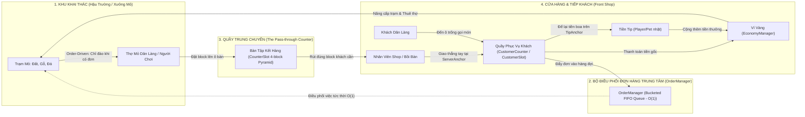

# MineMart: Idle Block Tycoon — Master Game Design Document

> **Bản Đặc Tả Thiết Kế Game Tổng Thể (Master GDD)**  
> *Tài liệu định hình toàn bộ tầm nhìn sản phẩm, cơ chế gameplay, hệ thống kinh tế vi mô/vĩ mô, kiến trúc dữ liệu và tiêu chuẩn kỹ thuật cho toàn bộ vòng đời phát triển dự án MineMart.*

---

## 1. Tầm Nhìn & Định Vị Sản Phẩm (Vision & Positioning)

### 1.1 Tuyên Ngôn Dự Án (One-Sentence Pitch)
**MineMart: Idle Block Tycoon** là tựa game mô phỏng quản lý kinh doanh nhàn rỗi (Idle Tycoon) kết hợp điều khiển trực tiếp (Arcade Hybrid Control) lấy cảm hứng từ thế giới khối vuông Voxel, nơi người chơi cùng các Dân làng (Villagers) xây dựng, tự động hóa và bành trướng chuỗi siêu thị chế tác block trải dài qua nhiều quần xã kỳ ảo, mang lại cảm giác thỏa mãn kinh tế lũy tiến và phản hồi giác quan đậm đặc.

### 1.2 Trụ Cột Trải Nghiệm (Core Pillars)
1. **Quản Lý Nhàn Rỗi Kết Hợp Điều Khiển Trực Tiếp (Hybrid Agency)**: Không bắt người chơi chỉ nhìn màn hình một cách thụ động. Game trao quyền tối thượng: buông tay thì xưởng tự vận hành 100%, chạm tay thì trực tiếp điều khiển nhân vật can thiệp để tối ưu hóa năng suất tức thì.
2. **Kinh Tế Lũy Tiến Đa Tầng (Multi-Tiered Progression Loop)**: Kết hợp mượt mà giữa tiến trình vi mô (nâng cấp từng quầy), trung mô (cải tạo xưởng từng màn bằng Vàng) và vĩ mô (xây dựng đế chế vĩnh viễn bằng Emerald và đồ bộ RPG).
3. **Mãn Nhãn & Thỏa Mãn Giác Quan (Deep Voxel Juice)**: Từng khối block nảy nở, các cột hàng xếp cao ngút mắt, âm thanh khai khoáng giòn giã và phản hồi rung tinh tế biến mỗi giây trải nghiệm thành một liều kích thích dopamine tự nhiên.

### 1.3 Bảng Điểm Bán Hàng Độc Nhất (Unique Selling Propositions - USPs)

| STT | Điểm Bán Hàng Độc Nhất (USP) | Giá Trị Khác Biệt Cạnh Tranh So Với Thị Trường |
|---|---|---|
| **USP 1** | **Điều Khiển Lai Linh Hoạt & Khai Thác Theo Đơn (Hybrid Control & Order-Driven Mining)** | Người chơi có thể tự do chuyển đổi giữa **Pure-Idle** (Tắt Joystick, nhân vật chính tự động làm việc như một siêu thợ) và **Arcade Active** (Bật Joystick nổi, tự tay chạy việc; mỏ chỉ hút dứt khoát *Magnet Pop-Snap* và khóa chân khi có đơn hàng, chạy ngang tự do khi không có order). |
| **USP 2** | **Chuỗi Cung Ứng Hai Quầy & Giao Trực Tiếp (Two-Counter Logistics & Direct Handover)** | Đột phá luồng vận hành: Tách riêng **Quầy Trung Chuyển** (chứa các ô `CounterSlot` kim tự tháp tam giác 4 block đồng nhất loại) và **Quầy Tiếp Khách** (mặt tiền giao dịch). Tích hợp cơ chế **Giao hàng trực tiếp (Direct Handover)**: trao thẳng tay nhận tiền ngay cho khách đang đợi, chống nghẽn chuyền tuyệt đối. |
| **USP 3** | **Trang Bị RPG Tự Do Chỉ Số & Thú Cưng Nhặt Tip (Freeform RPG Gear & Tip Pet)** | Hệ thống 7 slot trang bị chuẩn Minecraft (Mũ, Áo, Quần, Giày, Tay chính, Tay phụ, Pet). Các slot **không bị khóa chết chỉ số** mà có thể chứa bất kỳ dòng buff nào, mở ra vô số trường phái build đồ độc lạ. Thú cưng có AI riêng tự lon ton đi nhặt tiền boa rơi trên sàn. |
| **USP 4** | **Trang Phục Dân Làng Tự Động Biến Đổi Theo Quần Xã (Biome-Adaptive Villagers - No Grind)** | **Không biến ngoại hình dân làng thành cơ chế cày cuốc**. Khi bước sang Biome mới (Đồng Bằng, Hang Đá, Sa Mạc, Nether), toàn bộ thợ và khách hàng tự động khoác lên mình trang phục truyền thống của vùng đất đó, mang lại phần thưởng thị giác khám phá tự nhiên ngay đầu game. |

---

## 2. Vòng Lặp Trò Chơi (Core Loop & Macro Systems)

### 2.1 Sơ Đồ Vòng Lặp Khép Kín Dây Chuyền Chuỗi Cung Ứng (Supply-Chain Pipeline)



### 2.2 Máy Trạng Thái Đơn Hàng Dây Chuyền (Order Lifecycle Pipeline)
Mọi đơn hàng vận hành theo một quy trình 5 bước được giám sát chặt chẽ:
1. `CUSTOMER_ORDER`: Khách Dân làng tự tìm ô trống bước tới `CustomerAnchor` tại **Quầy Phục Vụ Khách (`CustomerCounter`)** $\rightarrow$ Đẩy đơn hàng (`OrderTicket`) vào **Bộ Điều Phối Trung Tâm (`OrderManager`)**.
2. `MINING_DISPATCH`: `OrderManager` phân loại đơn vào ngăn FIFO của loại block đó ($O(1)$). Trạm Mỏ tương ứng phát hiện có đơn cần đào (`HasOrderInQueue = true` $\rightarrow$ `NeedsMining = true`). Thợ mỏ / người chơi di chuyển đến mỏ nhận đơn (`ClaimNextOrder`) và đào đúng số lượng được order. Khi không có order, mỏ ở trạng thái IDLE và người chơi di chuyển tự do không bị hút dính.
3. `PASS_THROUGH_DROP`: Thợ mang block đào xong lên **Quầy Trung Chuyển (`CheckoutCounter`)**, đứng ở `PlaceAnchor` đặt vào ô `CounterSlot` phù hợp (xếp kim tự tháp tam giác 4 block đồng nhất loại).
4. `SHOP_RUNNER_PICKUP`: Nhân viên cửa hàng đến đứng ở `TakeAnchor` quầy trung chuyển rút đúng loại block mà khách đang chờ.
5. `DIRECT_HANDOVER_AND_TIP`: Nhân viên mang block ra đứng ở `ServerAnchor` phía sau ô khách của **Quầy Phục Vụ Khách** trao thẳng tay cho khách $\rightarrow$ `OrderManager` hoàn tất đơn hàng (`CompleteOrder`), bắn sự kiện `OnOrderDelivered` để `EconomyManager` cộng tiền vàng gốc và `JuiceManager` phát hiệu ứng nổ hạt. Khách để lại **Tiền Tip** tại `TipAnchor` trên mặt bàn rồi rời đi, giải phóng ô cho khách tiếp theo. Người chơi hoặc Thú cưng (Pet) chạy qua chạm vào để thu gom tiền tip.

---

## 3. Đặc Tả Cơ Chế Gameplay Chi Tiết (Detailed Gameplay Mechanics)

### 3.1 Hệ Thống Điều Khiển Lai (Hybrid Control Architecture)
- **Chế độ Tự Động (Auto-Pilot / Idle)**:
  - Khi người chơi buông tay khỏi màn hình, nhân vật chính tự động đóng vai trò **Thợ Đa Năng Cấp Cao**, tự tìm đến quầy đang thiếu thợ hoặc quầy có giá trị cao nhất để hỗ trợ.
- **Chế độ Điều Khiển Tay (Manual Active Arcade)**:
  - Chạm và kéo ngón tay trên màn hình: Xuất hiện **Dynamic Floating Joystick** (Cần gạt nổi sinh ra ngay vị trí chạm, không bắt người chơi với tay).
  - Tốc độ di chuyển: $4.5\text{ m/s}$ (tăng thêm khi mặc trang bị có chỉ số `WalkSpeed`).
  - **Khai Thác Theo Đơn Hàng & Hút Dứt Khoát (Order-Driven Mining & Magnet Pop-Snap)**:
    - **Chỉ đào khi có Order**: Trạm mỏ chỉ mở tương tác và kích hoạt hút khi khách hàng đang có đơn hàng chờ loại block đó (`NeedsMining = true`). Khi không có ai order, mỏ ở trạng thái IDLE và người chơi di chuyển tự do ngang qua mỏ mà **tuyệt đối không bị hút dính hay khóa chân**.
    - **Hút Dứt Khoát (Pop Snap)**: Khi tiếp cận mỏ đang có order ($R \le 1.6\text{m}$), nhân vật lập tức bị hút dứt khoát "póc" vào điểm neo `MinerAnchor`, kích hoạt hiệu ứng Squash & Stretch ($0.16\text{s}$) đàn hồi như nam châm dính cộp và **khóa cứng di chuyển** không cho đi lung tung cho đến khi khai thác xong block. Khi block đã lên đầu thì tự động mở khóa và trừ 1 đơn hàng pending.
- **Cài đặt Bật/Tắt Joystick**:
  - Người chơi có thể gạt tắt Joystick trong menu Cài Đặt để thưởng thức phong cách Pure-Idle màn hình dọc truyền thống.

```gherkin
Feature: Order-Driven Mining & Magnet Pop-Snap with Action Lock
  Scenario: Chạy ngang qua mỏ tự do khi không có Order
    Given trạm Mỏ Đất đã mở khóa nhưng hiện không có khách nào order Đất
    When người chơi điều khiển nhân vật chạy ngang qua Mỏ Đất
    Then nhân vật không bị hút dính vào mỏ và tiếp tục di chuyển tự do

  Scenario: Hút dứt khoát và khóa cứng di chuyển khi có Order cần đào
    Given có khách hàng đang chờ đơn Block Đất tại Quầy Tiếp Khách
    When nhân vật bước vào bán kính tương tác của Mỏ Đất
    Then nhân vật bị hút dứt khoát "póc" vào đúng điểm neo MinerAnchor
    And input di chuyển bị khóa cứng hoàn toàn trong suốt thời gian đào
    And khi đào xong, block được nhấc lên đầu, 1 order được tiêu thụ và mở khóa di chuyển
```

---

### 3.2 Hệ Thống Hai Quầy Chuyên Biệt (Pass-through Counter & Customer Counter)

Hệ thống phân tách rạch ròi giữa 2 loại quầy trong tiệm:

#### A. Quầy Trung Chuyển Tiếp Nhận Hàng (The Pass-through Counter — `CheckoutCounter`)
- **Vị trí**: Đặt tại ranh giới ngăn cách giữa Khu Khai Thác (hậu trường) và Khu Cửa Hàng (mặt tiền).
- **Kiến trúc Ô Độc Lập (`CounterSlot`)**:
  - Mỗi ô sở hữu: Điểm neo mặt bàn (`TableAnchor`), Điểm đặt hàng phía sau (`PlaceAnchor` - Phía Mỏ) và Điểm lấy hàng phía trước (`TakeAnchor` - Phía Shop).
  - **Quản lý phân loại hàng hóa**: Mỗi ô chỉ chứa đồng nhất 1 loại `BlockDataSO` (không lẫn lộn Đất với Gỗ).
  - **Sức chứa Kim Tự Tháp Tam Giác**: Tối đa 4 block $0.4\text{m}$ / ô (3 block đáy tam giác phẳng + 1 block đỉnh chóp).
- **Luồng thao tác nghiêm ngặt 2 phía**:
  - Phía Mỏ: Thợ mỏ / Người chơi CHỈ được đặt block khi đứng tại `PlaceAnchor` trước mặt ô đó (`GetSlotAtPlacePosition`).
  - Phía Shop: Nhân viên cửa hàng / Người chơi phục vụ CHỈ được nhấc block khi đứng tại `TakeAnchor` trước mặt ô đó (`TryTakeBlockAtTakeAnchor`). Đứng sai phía sẽ bị từ chối tương tác $100\%$.

#### B. Quầy Phục Vụ Khách Hàng (Customer Service Counter — `CustomerCounter` & `CustomerSlot`)
- **Vị trí**: Đặt tại mặt tiền tiệm tiếp xúc trực tiếp với người mua.
- **Kiến trúc Bàn Dài Nhiều Ô Đón Khách (`CustomerSlot`)**:
  - Hỗ trợ cả bàn đơn lẻ 1 khách lẫn bàn dài mở rộng nhiều vị trí đón khách độc lập (`CustomerSlot[]`).
  - Mỗi ô tiếp khách sở hữu bộ ba điểm neo chuẩn hóa:
    1. **`CustomerAnchor`**: Điểm neo dưới sàn phía trước quầy nơi khách đứng chờ đặt món và nhận hàng.
    2. **`ServerAnchor`**: Điểm neo dưới sàn phía sau quầy nơi nhân viên / người chơi đứng phục vụ riêng cho ô đó. *(Bắt buộc người phục vụ phải đứng ở phía sau quầy, khoảng cách $\le 0.85\text{m}$ tới `ServerAnchor` và gần `ServerAnchor` hơn `CustomerAnchor`. Tuyệt đối không được giao hàng khi đứng ở vị trí của khách).*
    3. **`TipAnchor`**: Điểm neo trên mặt bàn tương ứng với ô đó, nơi tiền tip (tiền boa) xuất hiện sau khi phục vụ xong.
- **Cơ Chế Giao Hàng Thẳng & Sinh Tiền Tip (Direct Handover & Tip Mechanics)**:
  - **Khách hàng (NPC Customer AI)**: Tự động tìm đến ô tiếp khách còn trống (`GetAvailableSlot` / `GetClosestAvailableSlot`) để vào vị trí gọi món.
  - **Giao hàng thẳng**: Nhân viên/Người chơi mang block đúng loại đến đứng tại `ServerAnchor` của ô đó và trao thẳng tay cho khách (`TryDeliverOrderAtPosition`).
  - **Thanh toán tức thì & Sinh Tiền Tip**:
    - Hệ thống bắn sự kiện `OrderDeliveredEventChannelSO` thanh toán tiền giá gốc đơn hàng vào ngân sách.
    - Đồng thời, khách hàng để lại **Tiền Tip (vàng/tiền boa)** xuất hiện ngay tại `TipAnchor` trên mặt bàn của ô đó.
    - Tiền tip nằm chờ trên mặt bàn cho đến khi người chơi hoặc Thú cưng (Pet Collector AI) chạy qua chạm vào để thu gom (Collect-on-touch), kích hoạt âm thanh leng keng và cộng thêm tiền thưởng vào ví.

```gherkin
Feature: Two-Counter Logistics Pipeline, Direct Handover & Tip Drop
  Scenario: Đặt block phân loại lên Quầy Trung Chuyển từ Phía Đặt
    Given thợ mỏ vừa đào xong 1 Block Đất
    When thợ đứng ở PlaceAnchor (Phía Mỏ) của ô CounterSlot
    Then block được xếp vào ô CounterSlot đang chứa Đất hoặc ô hoàn toàn trống
    And block được xếp theo hình học kim tự tháp tam giác 4 khối

  Scenario: Lấy block từ Quầy Trung Chuyển từ Phía Lấy
    Given ô CounterSlot đang chứa ít nhất 1 Block Đất
    When nhân viên cửa hàng đứng ở TakeAnchor (Phía Shop) của ô đó
    Then 1 block được nhấc lên đầu nhân viên để mang đi phục vụ
    And người đứng ở PlaceAnchor không thể nhấc block

  Scenario: Giao hàng thẳng và sinh Tiền Tip tại Quầy Tiếp Khách
    Given một Khách Dân làng đang đứng chờ nhận Block Đất tại ô CustomerSlot
    When nhân viên mang Block Đất tới đứng đúng ServerAnchor phía sau quầy của ô đó
    Then block được trao thẳng tay cho khách hàng mà không cần đặt lên bàn
    And hệ thống cộng tiền vàng giá gốc đơn hàng vào ví tức thì
    And một bọc Tiền Tip xuất hiện tại TipAnchor trên mặt bàn của ô đó
    And khách hàng rời khỏi ô, giải phóng ô cho khách tiếp theo
```

---

### 3.3 Phân Loại 3 Cấu Trúc Map (Map Archetypes & Roles)
Game hỗ trợ 3 kiểu cấu trúc mặt bằng tiệm để đổi mới trải nghiệm qua từng màn chơi:
1. **Kiểu 1 — Quầy Trực Tiếp (Street Stall / Kiosk)**:
   - Khách đứng trước quầy, Thợ đứng sau quầy giao tận tay, khách nhận đồ rồi rời đi ngay.
2. **Kiểu 2 — Quầy Tiếp Khách Tập Trung & Quầy Trung Chuyển (Central Service Counter Mart)**:
   - Khách tập trung tại Quầy Tiếp Khách mặt tiền. Thợ mỏ tập kết block lên Quầy Trung Chuyển, nhân viên shop bưng block ra quầy tiếp khách giao tận tay.
3. **Kiểu 3 — Khu Bàn Ghế & Bồi Bàn (Dine-in Workshop with Waiters)**:
   - Khách bước vào ngồi tại các Bàn ghế trong tiệm.
   - **Bồi bàn (Waiter)**: Chạy lại bàn nhận order $\rightarrow$ đẩy vào `OrderQueue` $\rightarrow$ Thợ tự động chế tác $\rightarrow$ Bồi bàn bưng ra bàn cho khách $\rightarrow$ Khách ăn xong để lại tiền vàng và tiền boa.

---

### 3.3.A Hệ Thống Lưới Không Gian Bản Đồ & Snap Bố Trí 1:1 (Voxel Grid Map & Scene Snap Placement)
- **Tổ chức không gian theo Lưới Ô Vuông (Integer Grid Mapping)**:
  - Toàn bộ mặt bằng bản đồ xưởng chế tác được phân chia theo lưới tọa độ Descartes hai chiều chuẩn Voxel: mỗi ô tương ứng kích thước hình học chính xác $1.0\text{m} \times 1.0\text{m}$ trên mặt phẳng nằm ngang $(X, Z)$.
  - Trục tọa độ chuẩn hóa: Tâm mỗi ô luôn nằm tại các tọa độ số thực nửa nguyên $(X + 0.5, Z + 0.5)$ hoặc số nguyên tròn $(X, Z)$ tùy quy ước điểm neo (Pivot).
- **Cơ chế Hút Ô Lưới (Scene View Grid Snapping)**:
  - Tích hợp trực tiếp công cụ hiển thị Grid View trên Scene View trong Unity Editor (trục $XZ$, kích thước $1\text{m}$).
  - Áp dụng cấu hình `Increment Snap = 1.0m`. Khi nhà phát triển kéo thả bố trí Quầy hàng, Bàn chế tác, Bàn ghế hay Cọc đệm, vật thể tự động hít (Snap) chính xác vào lưới tọa độ nguyên, mang lại trải nghiệm biên tập trực quan như một chế độ Edit Mode của game.

---

### 3.4 Thuật Toán Điều Phối Công Việc & Di Chuyển Nguyên Tố 1:1 (Task Dispatcher & Discrete 1:1 Grid Stepping)
- **Trọng tài thời gian & khoảng cách**:
  - `OrderQueue` quản lý đơn theo chuẩn **FIFO** (Đến trước phục vụ trước).
  - Khi có nhiều Thợ rảnh, hệ thống áp dụng **Distance Tie-breaker**: Thợ ở gần quầy cần làm nhất sẽ nhận việc.
- **Di chuyển nguyên tố 1:1 (Discrete Integer Grid Stepping)**:
  - **Tọa độ logic tuyệt đối hóa số nguyên**: Vị trí của toàn bộ Dân làng (Thợ, Bồi bàn, Khách hàng) trong bộ nhớ được quản lý bằng cấu trúc `Vector3Int` hoặc `Vector2Int`. Triệt tiêu hoàn toàn hiện tượng trôi dạt tọa độ số thực (Float Drifting) lẻ tẻ như `(1.4238, 0, 3.8761)`.
  - **Lộ trình từng bước (Tile-by-Tile Stepping)**: Lộ trình từ vị trí hiện tại đến đích được phân rã thành danh sách các tọa độ nguyên kề nhau (Manhattan Navigation Path).
  - **Nội suy chuyển động mượt mà (Kinematic Interpolation)**: Nhân vật lướt từ tâm ô hiện tại sang tâm ô kế tiếp trong thời gian cố định ($0.25\text{s/ô}$ theo tốc độ cơ bản $4.0\text{m/s}$), kết hợp nhịp lắc lư (Bobbing) vui mắt. Khi dừng lại, vị trí logic và Transform luôn được chốt cứng tại tọa độ số nguyên tròn trịa $1:1$.
- **Đi xuyên thấu (Pass-through Agents)**:
  - Toàn bộ Dân làng và người chơi không va chạm vật lý với nhau (Zero Character Collision), loại bỏ triệt để lỗi kẹt đường, nghẽn lối đi trên lưới.

---

### 3.5 Hệ Thống Quần Xã (Biomes Progression) & Trang Phục Dân Làng
Game xây dựng 4 Quần xã đặc trưng với hệ sinh thái block và trang phục dân làng tự động biến đổi:

| Quần Xã (Biome) | Danh Sách Quầy & Block | Môi Trường & Ánh Sáng | Trang Phục Dân Làng (Tự Động) |
|---|---|---|---|
| **1. Đồng Bằng (Plains)** | Đất, Gỗ Sồi, Đá Cuội, Lúa Mì | Đồng cỏ xanh tươi, nắng vàng rực rỡ | Áo nâu thắt lưng xanh, nón rơm nông dân kinh điển |
| **2. Hang Khai Khoáng (Stone Caves)** | Than Đá, Quặng Sắt, Vàng, Kim Cương | Hang đá lung linh ánh đuốc, huyền bí | Mũ bảo hộ gắn đèn, tạp dề da thợ mỏ |
| **3. Sa Mạc (Desert)** | Cát, Kính Thủy Tinh, Sa Thạch, Đất Nung | Cát vàng, kim tự tháp, nắng chói chang | Áo choàng vải trùm đầu màu vàng cát chống nắng |
| **4. Địa Ngục (Nether Realm)** | Đá Nether, Thạch Anh, Bột Lửa, Netherite | Dung nham đỏ rực, khói bụi âm u | Trang phục Piglin / Giáp da thợ rèn chịu lửa |

```gherkin
Feature: Biome-Adaptive Villager Outfits
  Scenario: Dân làng tự động đổi trang phục theo Biome hiện tại
    Given người chơi hoàn thành Biome Đồng Bằng và chuyển sang Biome Sa Mạc
    When cảnh Sa Mạc được tải và spawn các Dân làng
    Then toàn bộ Dân làng nhân viên và khách hàng tự động mang Skin trang phục Sa Mạc (Desert Outfit)
    And người chơi không cần phải trả thêm bất kỳ loại tiền tệ nào để mở khóa ngoại hình này
```

---

### 3.6 Hệ Thống RPG 7 Slot, Thú Cưng & Phù Phép (RPG Meta)

#### A. 7 Slot Trang Bị Chuẩn Voxel
1. **Mũ (Helmet)**
2. **Áo (Chestplate)**
3. **Quần (Leggings)**
4. **Giày (Boots)**
5. **Tay Chính (Main Hand)**: Cúp, Rìu, Xẻng, Kiếm.
6. **Tay Phụ (Off-Hand)**: Khiên, Totem Bất Tử, Đuốc.
7. **Thú Cưng (Pet)**: Chó Sói, Mèo Mướp, Vẹt, Axolotl...

#### B. Cơ Chế Chỉ Số Tự Do (Freeform Stat System)
Không cố định chỉ số theo slot (Mũ không nhất thiết chỉ tăng máu/giáp). Bất kỳ món đồ nào cũng có thể roll ra bất kỳ dòng buff nào trong danh mục:
- `AllProfitMultiplier` (+% Tổng doanh thu xưởng)
- `WalkSpeed` (+% Tốc độ di chuyển nhân vật/thợ)
- `CraftSpeed` (+% Tốc độ chế tác block)
- `InstantCraftChance` (% Cơ hội hoàn thành block ngay lập tức 0 giây)
- `DoubleValueChance` (% Cơ hội nhân đôi giá trị đơn hàng)
- `TipBonusRate` (% Khách boa thêm tiền)

#### C. Cơ Chế Thú Cưng Nhặt Tip (Autonomous Tip Collector Pet)
- Thú cưng vừa mang chỉ số nội tại cho người chơi, vừa có **AI hành vi độc lập**: Khi khách hàng rời đi và để lại tiền boa rơi trên sàn, Pet sẽ tự động chạy lon ton đến nhặt từng đồng tiền boa về ví người chơi!

#### D. Bàn Phù Phép Trang Bị (Equipment Enchantment System)
- Người chơi sử dụng Bàn Phù Phép (Enchanting Table) và Sách Phù Phép để cường hóa trang bị, mở thêm các dòng chỉ số phụ (Secondary Stat Modifiers): *Efficiency (Tăng tốc chế tác), Fortune (Tăng tiền tip), Unbreaking (Gia tăng hiệu suất toàn xưởng)*.

#### E. Tiến Trình Mở Khóa Trang Bị Lũy Tiến (Progressive Gear Slot Unlocking)
*Trị dứt điểm "Hố sâu Quá tải nhận thức" (Cognitive Overload)*: Không mở toang 7 slot ngay từ đầu khiến người chơi casual bị ngợp. Thay vào đó, các slot trang bị được mở khóa tuần tự theo từng Quần xã (Biome Progression):
- **Biome 1 (Đồng Bằng)**: Chỉ mở **3 Slot cơ bản**: **Tay Chính (Main Hand)** + **Mũ (Helmet)** + **Thú Cưng (Pet)**. Đơn giản, nhẹ đầu, dễ tiếp cận như *Eatventure*.
- **Biome 2 (Hang Khai Khoáng)**: Mở khóa thêm **Áo Giáp (Chestplate)** và **Tay Phụ (Off-Hand)**.
- **Biome 3 & 4 (Sa Mạc & Nether)**: Mở khóa nốt **Quần (Leggings)**, **Giày (Boots)** và **Bàn Phù Phép (Enchanting Table)**.
$\rightarrow$ Vừa chống ngợp, vừa biến các slot trang bị thành phần thưởng mở khóa tính năng (Feature Unlocks) kích thích người chơi cày cuốc vượt qua các map mới!

---

### 3.7 Dây Chuyền Ghép Block (Assembly Crafting Recipes — Kích Hoạt Từ Biome 2)
*Trị dứt điểm "Hố sâu Đơn điệu hóa" (Trả lại cái hồn chế tác Voxel đích thực)*:
- **Nguyên tắc phân tầng**:
  - **Biome 1 (Đồng Bằng)**: Giữ nguyên chế tác nguyên liệu thô độc lập (Đất, Gỗ, Đá) để người chơi nắm chắc Core Loop.
  - **Biome 2 (Hang Khai Khoáng) trở đi**: Kích hoạt **Đơn Hàng Phức Hợp (Crafting Recipes)**:
    - Khách thường: Mua Than thô hoặc Ván gỗ thô.
    - Khách VIP / Nhà Thám Hiểm: Yêu cầu sản phẩm ghép: **Cây Đuốc (Torch)** (Cần 1 Quầy Gỗ làm Gậy + 1 Quầy Than nung Than $\rightarrow$ Ghép thành Đuốc).
    - Biome 3 (Sa Mạc): **Kính Thủy Tinh Khung Gỗ** (Cát nung + Gỗ).
    - Biome 4 (Nether): **Kiếm Kim Cương Bọc Netherite**.
- **Giá trị kinh tế**: Đơn hàng phức hợp mang lại lợi nhuận gấp $3 - 5\text{ lần}$, tạo chiều sâu chiến thuật sắp xếp quầy hàng và điều phối thợ mà không làm phá vỡ tính nhàn rỗi cốt lõi.

---

### 3.8 Sổ Tay Dân Làng VIP & Bộ Sưu Tập (Villager Guest Book / Collection Album)
*Vũ khí kích hoạt tâm lý sưu tầm (Collector Mindset & FOMO)*:
- **Cơ chế**: Khi cửa hàng đạt các cột mốc doanh thu hoặc kích hoạt sự kiện đặc biệt, những vị khách Dân làng huyền thoại sẽ xuất hiện:
  - *Iron Golem Khổng Lồ*: Đòi mua 10 khối Sắt.
  - *Pháp Sư Dân Làng (Cleric)*: Đòi mua Bột Đá Đỏ và Thủy Tinh.
  - *Dân Làng Cưỡi Lạc Đà (Camel Trader)*: Đòi mua Khối Xương và Sa Thạch.
- **Phần thưởng vĩnh viễn**: Khi phục vụ thành công, họ sẽ **ký tên và đóng dấu vào Sổ Tay Dân Làng VIP** của người chơi, tặng vĩnh viễn một mốc buff toàn cầu (Ví dụ: Iron Golem tặng $+2\%$ All Profit vĩnh viễn).

---

## 4. Kinh Tế & Cân Bằng Tiến Trình (Economy & Progression Balance)

### 4.1 Hệ Thống Tiền Tệ Kép (Dual Currency System)
- **Tiền Vàng (Gold Coins - Soft Currency)**:
  - Nhận được từ việc bán block thành phẩm cho khách.
  - Dùng để nâng cấp Level quầy, mua thêm quầy nghề mới, và mua các nâng cấp xưởng trong màn hiện tại.
  - Reset khi người chơi mở rộng sang Quần xã (Biome) mới.
- **Ngọc Lục Bảo (Emeralds - Hard Currency)**:
  - Nhận được từ phần thưởng nhiệm vụ, khách VIP boa, hoặc mua IAP.
  - Dùng để quay Rương Trang Bị (Lootbox), nâng cấp Cây Vĩnh Viễn The Vault, mua Skin sự kiện.
  - **Không bao giờ bị reset**.

---

### 4.2 Tiến Trình Kinh Tế 3 Tầng & Cơ Chế "Hạ Cánh Mềm" (Soft Landing)

```
                            TIẾN TRÌNH KINH TẾ CỦA MINEMART
                                          |
        +---------------------------------+---------------------------------+
        |                                 |                                 |
 [TẦNG 1: VI MÔ]                  [TẦNG 2: TRUNG MÔ]                [TẦNG 3: VĨ MÔ]
"Cột Mốc Từng Quầy Lẻ"           "Cải Tạo Xưởng Từng Màn"          "Đế Chế Vĩnh Viễn"
(Dùng Vàng - Reset theo Biome)   (Dùng Vàng - Reset theo Biome)    (Dùng Emerald - Bền vững)
```

#### Tầng 1: Cột Mốc Quầy Lẻ (Stall Milestones & FTUE Onboarding)
- **Cơ Chế Khởi Động Tân Thủ & Mở Khóa Quầy (First-Time User Onboarding)**:
  - Toàn bộ các quầy trong màn chơi đều khởi đầu ở trạng thái **Chưa Mở Khóa (`Level = 0`)**.
  - **Quầy khởi đầu (Quầy Đất / Khối bậc 1)**: Có giá mở khóa quy định là **$0\text{ Vàng}$**. Người chơi bắt buộc phải tự tay thực hiện thao tác tương tác đầu tiên: **Bấm nút Mở Khóa ($0 Vàng)** để quầy trồi lên từ mặt đất, kích hoạt **Cấp độ 1 (`Level = 1`)** và bắt đầu chu kỳ sản xuất. Thao tác này kích hoạt hiệu ứng tâm lý sở hữu (Ikea Effect) và dạy luật chơi trực quan: *"Muốn có quầy thì phải đầu tư mở khóa"*.
  - **Các quầy kế tiếp**: Mở khóa tuần tự khi người chơi tích lũy đủ số Vàng tương ứng (`buyPrice`). Khi chưa đủ tiền, nút bấm ở trạng thái khóa xám.
  - **Chu kỳ nâng cấp**: Sau khi mở khóa thành công (Level $\ge 1$), nút bấm chuyển đổi chức năng sang **Nâng Cấp (Level Up)** với chi phí tăng dần.
- **Công thức giá nâng cấp**: $\text{Cost}(L) = \text{BaseCost} \times (1.15)^{L - 1}$
- **Các mốc đột phá doanh thu (Milestones)**:
  - **Lv 10**: Giá trị doanh thu $\times 2$.
  - **Lv 25**: Giá trị doanh thu $\times 2$ (Cộng dồn thành $\times 4$).
  - **Lv 50**: Giá trị doanh thu $\times 2$ (Cộng dồn thành $\times 8$).
  - **Lv 100**: Giá trị doanh thu $\times 3$ (Cộng dồn thành $\times 24$).

#### Tầng 2: Cây Nâng Cấp Xưởng Màn Chơi (In-Stage Upgrades bằng Vàng)
- Mua thêm Giường ngủ (Triệu hồi thêm Thợ dân làng, tối đa 4 thợ).
- Lát sàn đá mịn (Tăng 30% tốc độ chạy toàn xưởng).
- Biển hiệu cửa hàng (Tăng 50% tần suất khách ghé tiệm).
- Mua thêm Quầy Tiếp Khách phụ (Phục vụ 2 khách song song) & Mở rộng thêm ô Quầy Trung Chuyển.

#### Tầng 3: Cây Nâng Cấp Vĩnh Viễn The Vault & Cơ Chế "Hạ Cánh Mềm" (Soft Landing)
*Trị dứt điểm "Hố sâu Cú sốc mất trắng khi reset Biome"*:
1. **Vốn Khởi Nghiệp Biome (The Seed Capital)**: Được nâng cấp trong The Vault bằng Emerald. Khi bước sang Biome mới, hệ thống lập tức rót ngay một khoản tiền Vàng đủ để người chơi **mở ngay 2 quầy đầu tiên và nâng lên Lv 10 trong 30 giây đầu**, triệt tiêu cảm giác phải cày lại từ con số 0.
2. **Xe Buôn Di Sản Biome Cũ (Biome Legacy Caravan)**: Biome cũ đã hoàn thành sẽ định kỳ gửi một xe buôn hàng viện trợ vàng thụ động sang xưởng mới mỗi giờ.
3. **Ad Boost Multiplier**: Tăng hệ số nhân doanh thu x2 lên x2.2, x2.5... x5.0.
4. **Tip Chance**: Tăng tỉ lệ khách để lại tiền boa từ 5% lên tối đa 40%.
5. **Max Offline Timer**: Tăng thời gian tích lũy AFK từ 2 giờ lên 4, 8, 12, 24 giờ.

---

### 4.3 Chiến Lược Kiếm Tiền & Chuyển Đổi Thương Mại (Monetization & Conversion Funnel)

1. **Quảng Cáo Nhận Thưởng (Rewarded Ads - Không ép buộc)**:
   - **Boost Doanh Thu x2**: Xem 1 video quảng cáo nhận x2 lợi nhuận toàn tiệm trong 5 phút.
   - **Thương Nhân Lang Thang (Wandering Trader)**: Tặng vàng hoặc emerald miễn phí khi người chơi chọn xem quảng cáo.
2. **Cơ Chế Phá Băng Tân Thủ — Heo Đất Dân Làng (The Piggy Bank / Break-the-Bank Mechanic)**:
   - *Đòn bẩy tâm lý chuyển đổi người chơi miễn phí thành người trả tiền lần đầu (First-Time Payer Conversion)*:
   - **Quy tắc vận hành**: Mỗi khi xưởng bán được một đơn hàng, hệ thống bí mật trích một tỷ lệ nhỏ quy đổi thành Ngọc Lục Bảo (Emeralds) và tích lũy vào **Heo Đất (Piggy Bank)**.
   - **Ngưỡng đầy & Kích hoạt Offer**: Khi Heo Đất đạt $500\text{ Emeralds}$, màn hình xuất hiện một Popup hào nhoáng: *"Heo Đất Đã Đầy! Đập vỡ ngay chỉ với $0.99 (Tiết kiệm 80% so với mua trong Shop thường)!"*.
   - **Tâm lý học hành vi**: Ứng dụng *Hiệu ứng sở hữu (Endowment Effect)* và *Chi phí chìm (Sunk Cost)* — người chơi có cảm giác số Emeralds này là do chính mồ hôi công sức họ cày cuốc mà có, việc bỏ ra $0.99 chỉ là "lấy lại tài sản của chính mình", tạo tỷ lệ chuyển đổi mua hàng cao nhất trong ngành game mobile.
3. **Giao Dịch Trong Game (In-App Purchases - IAP Catalog)**:
   - **Gói Tân Thủ Khởi Nghiệp (Starter Pack - $1.99)**: 1 Trang bị Hiếm (Rare Pickaxe) + 100 Emeralds + 1 Pet Chó Sói nhặt tip.
   - **Vé Mùa (MinePass / Season Pass - $4.99)**: Mở khóa nhánh phần thưởng skin và thú cưng độc quyền theo tháng.
   - **Gói Gỡ Quảng Cáo Vĩnh Viễn (No Ads / VIP Ticket - $9.99)**: Tự động kích hoạt toàn bộ đặc quyền x2 reward vĩnh viễn không cần xem bất kỳ video nào.
   - **Các Gói Ngọc Lục Bảo Trực Tiếp**: Bán lẻ theo các mệnh giá từ $0.99 đến $49.99.

---

### 4.4 Sự Kiện Cuối Tuần & Đường Ống LiveOps Tự Động Hóa 100% (Automated LiveOps Pipeline)
*Giải tỏa triệt để nỗi lo chi phí vận hành (OpEx) cho Nhà đầu tư — Hệ thống chạy tự động vĩnh viễn*:
- **Cơ chế Lịch Trình Tự Hành (Calendar-Driven LiveOps)**:
  - Game được thiết kế để client tự động kích hoạt sự kiện dựa trên đồng hồ hệ thống / thời gian mạng (NTP Time Sync) mà **hoàn toàn không cần dev phải can thiệp máy chủ hay cập nhật ứng dụng thủ công**.
- **Lịch trình vận hành 4 tuần luân phiên (4-Week Rotating Cycle)**:
  - Cổng sự kiện tự động mở vào đúng **00:00 Thứ Sáu và đóng vào 23:59 Chủ Nhật (72 giờ)**:
    - *Tuần 1*: **Cổng Nether Thần Bí (Nether Incursion)** — Chế tác Khối Dung Nham, nhận Giáp Netherite.
    - *Tuần 2*: **Đảo Nấm Biển (Mushroom Island Gala)** — Thu hoạch Khối Nấm Phát Sáng, nhận Pet Bò Nấm (Mooshroom).
    - *Tuần 3*: **Đền Thờ Sa Mạc (Desert Temple Expedition)** — Khai quật Khối Sa Thạch Cổ, nhận Khiên Bất Tử.
    - *Tuần 4*: **Lãnh Nguyên Băng Giá (Frozen Tundra Blizzard)** — Khắc Băng Xanh, nhận Cúp Băng Giá.
- **Phần thưởng mang về map chính**: Khối lượng lớn **Ngọc Lục Bảo (Emeralds)** và **Mảnh Trang Bị Sự Kiện Huyền Thoại** độc quyền không thể quay được ở hòm thường, tạo động lực giữ chân người chơi bền bỉ từ D14 đến D60+.

---

## 5. Kiến Trúc Dữ Liệu & Cơ Sở Dữ Liệu (Database & Persistence)

Hệ thống phân định rạch ròi thành **3 Trụ Cột Độc Lập**, bảo đảm tính mở rộng và toàn vẹn dữ liệu:

```
                            HỆ THỐNG DỮ LIỆU CỦA MINEMART
                                          |
        +---------------------------------+---------------------------------+
        |                                 |                                 |
   [NHÓM 1: CONFIG]             [NHÓM 2: GLOBAL PROFILE]        [NHÓM 3: STAGE STATE]
  "Quy định gốc của game"       "Tài sản vĩnh viễn"             "Tiến trình màn hiện tại"
 (ScriptableObjects - Tĩnh)    (Save JSON - Vĩnh viễn)         (Save JSON - Reset theo Map/Event)
```

### 5.1 Nhóm 1: Config Data (Cơ Sở Dữ Liệu Tĩnh — ScriptableObjects / Read-Only)
- **`stallStartStatsManager`**: Bảng dữ liệu quầy gốc (`id_Stall`, `stall_Name`, `stall_buy_prices`, `stall_Start_Upgrade_Prices`, `stall_Start_generated_ore_timer`, `base_ore_value`, `milestone_rules`).
- **`stageConfigManager`**: Cấu hình từng màn (`stage_id`, `available_stall_ids`, `available_upgrade_ids`, `villager_skin_theme`, `crafting_recipes`).
- **`upgradeConfigManager`**: Thông số các gói nâng cấp Vàng và Emerald.
- **`equipmentConfigManager`**: Danh mục 7 slot trang bị, bậc phẩm chất và tỷ lệ roll chỉ số.

### 5.2 Nhóm 2: Global Profile (Hồ Sơ Toàn Cầu — Lưu Vĩnh Viễn Vào `savedata.json`)
- `emeralds`: Số lượng Ngọc Lục Bảo tích lũy toàn cục.
- `inventory`: Danh sách trang bị, vũ khí, thú cưng đang sở hữu.
- `unlocked_gear_slots`: Danh sách các slot đồ đã mở khóa (`Helmet`, `MainHand`, `Pet`...).
- `guest_book`: Danh sách chữ ký của các Khách Dân Làng VIP đã mở khóa (tặng buff vĩnh viễn).
- `emerald_vault_upgrades`: Cấp độ các node nâng cấp vĩnh viễn đã mua trong The Vault.
- `settings`: Trạng thái Bật/Tắt Joystick, Bật/Tắt Rung Haptics, Âm lượng.

### 5.3 Nhóm 3: Stage State (Trạng Thái Màn Đang Chơi — Lưu Vào `savedata.json`)
- `current_stage_id`: Mã màn đang mở (`"stage_01_plains"`).
- `stage_gold`: Tiền Vàng của màn hiện tại (được lưu riêng biệt).
- `stallManagerMap(n)`: Mảng trạng thái các quầy (`id_stall`, `stall_Unlocked`, `stall_level`).
- `stage_upgrades_purchased`: Danh sách các nâng cấp xưởng đã mua bằng Tiền Vàng trong màn.
- `last_offline_timestamp`: Dấu thời gian Unix thoát game để tính tiền nhàn rỗi.
- `active_weekend_event`: Nhánh lưu trữ độc lập khi người chơi tham gia Sự Kiện Cuối Tuần (`eventId`, `eventToken`, `eventStalls`).

### 5.4 Cấu Trúc File Lưu Trữ Thực Tế `savedata.json`

```json
{
  "saveVersion": 2,
  "lastOfflineTimestamp": 1727180000,
  
  "globalProfile": {
    "emeralds": 120,
    "settings": {
      "isJoystickEnabled": true,
      "isHapticsEnabled": true,
      "masterVolume": 0.8,
      "sfxVolume": 1.0
    },
    "unlockedGearSlots": ["MainHand", "Helmet", "Pet"],
    "guestBook": ["iron_golem_vip"],
    "piggyBankEmeralds": 240,
    "emeraldVaultUpgrades": {
      "ad_boost_multiplier": 2,
      "seed_capital_level": 3,
      "max_afk_hours": 2
    },
    "inventory": [
      { "id": "iron_pickaxe", "level": 5, "slot": "MainHand" },
      { "id": "dog_pet", "level": 1, "slot": "Pet" }
    ]
  },

  "currentStage": {
    "stageId": "stage_01_plains",
    "stageGold": "25400",
    "stallManagerMap": [
      { "id_stall": "stall_dirt", "stall_Unlocked": true, "stall_level": 50 },
      { "id_stall": "stall_wood", "stall_Unlocked": true, "stall_level": 25 },
      { "id_stall": "stall_stone", "stall_Unlocked": false, "stall_level": 0 }
    ],
    "stageUpgradesPurchased": [
      "upgrade_bed_1",
      "upgrade_smooth_stone_floor"
    ]
  },

  "activeWeekendEvent": null
}
```

---

## 6. Thiết Lập Kỹ Thuật & Tôn Chỉ Kiến Trúc (Architecture & Tech Specs)

### 6.1 Tôn Chỉ 100% Data-Driven & Decoupled Architecture
1. **Kiến trúc Sự Kiện Rời Rạc (Event-Driven SO Architecture)**:
   - **Tuyệt đối cấm cộng tiền trực tiếp trong code phục vụ khách hàng**.
   - Khi hoàn thành đơn, logic phục vụ chỉ phát tín hiệu `OnOrderDelivered` qua ScriptableObject Event Channel.
   - `EconomyManager` độc lập đón nhận sự kiện $\rightarrow$ tính toán Buff từ Trang bị/Ad $\rightarrow$ ghi nhận vào ví.
   - `JuiceManager` độc lập đón nhận sự kiện $\rightarrow$ sinh hạt tiền bay và phát âm thanh leng keng.
2. **Hệ Thống Trang Bị Đơn Nhất (Single Class `EquipmentData`)**:
   - Chỉ tồn tại duy nhất 1 ScriptableObject class `EquipmentData` chứa `List<StatModifier>`. Không bao giờ tạo class thừa cho từng món trang bị.

### 6.2 Tiêu Chuẩn Xử Lý Số Lớn & Ký Hiệu Rút Gọn (Large Number Math & Suffix Formatter)
*Trị dứt điểm "Hố sâu Tràn số nguyên" (Integer Overflow)*:
- **Kiểu dữ liệu tiền tệ**: Sử dụng kiểu **`double`** trong C# (hỗ trợ độ lớn lên tới $1.79 \times 10^{308}$, đáp ứng hoàn hảo chu kỳ lạm phát kinh tế của MineMart). Trong file JSON lưu trữ dưới dạng chuỗi String để đảm bảo tính toàn vẹn khi tuần tự hóa.
- **Quy chuẩn hiển thị rút gọn (Notation Formatter)**:
  - Giá trị $< 1,000$: Hiển thị số nguyên thuần (Ví dụ: `950`).
  - Giá trị từ $10^3$ đến $10^{12}$: Áp dụng ký tự chuẩn quốc tế:
    - $10^3 \rightarrow \textbf{K}$ (Thousand)
    - $10^6 \rightarrow \textbf{M}$ (Million)
    - $10^9 \rightarrow \textbf{B}$ (Billion)
    - $10^{12} \rightarrow \textbf{T}$ (Trillion)
  - Giá trị $> 10^{12}$: Chuyển sang hệ ký tự đôi chuẩn Incremental Game: `aa`, `ab`, `ac`... đến `zz`.
  - Quy tắc làm tròn: Luôn hiển thị tối đa **2 chữ số thập phân** (Ví dụ: `1.25M`, `45.80B`).

### 6.3 Tối Ưu Hiệu Năng Voxel, GPU Instancing & Object Pooling
*Trị dứt điểm "Hố sâu Khựng giật do rác bộ nhớ" (GC Alloc & Batching Draw Calls)*:
- **Nguyên tắc Quản Lý Bộ Nhớ (Zero Runtime Garbage Collection)**:
  - **Tuyệt đối cấm sử dụng `Instantiate()` và `Destroy()`** trong vòng lặp gameplay (sản xuất block, nảy tiền xu, sinh hiệu ứng hạt).
  - Bắt buộc áp dụng thư viện chuẩn của Unity: **`UnityEngine.Pool.ObjectPool<GameObject>`** để tái sử dụng tuần hoàn 100% các khối block 3D và đồng tiền vàng.
- **Tối ưu Hóa Lệnh Vẽ (GPU Instancing Batching)**:
  - Toàn bộ các khối block 3D (Đất, Gỗ, Đá, Than, Sắt...) dùng chung **1 Material duy nhất (Texture Atlas)** có bật cờ `Enable GPU Instancing`.
  - Toàn bộ tối đa 150 khối block xuất hiện đồng thời trên các quầy và cọc hàng được GPU gộp lại vẽ trong đúng **1 đến 2 Draw Calls**, bảo đảm tốc độ khung hình khóa cứng $60\text{ FPS}$ mượt mà trên mọi thiết bị Android tầm trung và yếu.

### 6.4 Công Thức Toán Thu Nhập Ngoại Tuyến Đại Số (Algebraic AFK Formula)
*Trị dứt điểm "Hố sâu Treo đơ máy do chạy giả lập thời gian" (Tick Simulation Crash)*:
- **Tuyệt đối cấm chạy vòng lặp giả lập (Tick Simulation)** để tránh nghẽn CPU khi người chơi vắng mặt nhiều ngày.
- **Công thức đại số tĩnh O(1)**: Tính toán chính xác doanh thu nhàn rỗi trong một phép tính duy nhất ngay khi mở game:
  $$\text{OfflineGold} = \sum_{i=1}^{n} \left(\frac{\text{Revenue}_i}{\text{CraftTime}_i}\right) \times \min(\Delta t, \text{MaxAFKSeconds}) \times \eta$$
  - $\Delta t = \text{currentTime} - \text{lastOfflineTimestamp}$ (Thời gian vắng mặt thực tế tính bằng giây).
  - $\text{MaxAFKSeconds}$: Giới hạn thời gian tích lũy tối đa (Mặc định 7,200s = 2 giờ; nâng cấp lên tối đa 24 giờ qua Cây Emerald).
  - $\eta = 0.5$: Hệ số hiệu suất nhàn rỗi (khuyến khích người chơi tương tác trực tiếp).

### 6.5 Tối Ưu Hóa Chỉ Số Trang Bị (Stat Caching & Dirty Flag Pattern)
*Trị dứt điểm "Hố sâu Lãng phí CPU khi tính toán chỉ số" (O(1) Delivery Lookup)*:
- **Cấm duyệt mảng 7 slot trang bị** mỗi khi một đơn hàng được giao thành công.
- **Mẫu Thiết Kế Dirty Flag Cache**:
  - Hệ thống sở hữu một đối tượng lưu trữ đệm **`EquipmentStatCache`**.
  - Logic tính toán gộp toàn bộ các chỉ số phần trăm (`AllProfitMultiplier`, `CraftSpeed`, `TipRate`...) chỉ được kích hoạt chạy **1 lần duy nhất khi người chơi Mặc đồ, Tháo đồ hoặc Nâng cấp đồ** (bắt sự kiện `OnEquipmentChanged`).
  - Khi hoàn thành giao block, `EconomyManager` chỉ việc đọc trực tiếp giá trị đã cache trong bộ nhớ với độ phức tạp tối ưu tuyệt đối $O(1)$.

### 6.6 Bộ Công Cụ Quản Trị & Gỡ Lỗi Trực Quan (Developer Admin Console & Debug Suite)
*Chuẩn mực công cụ nội bộ phục vụ cân bằng kinh tế và kiểm thử vòng lặp cấp tốc*:
- **Bảng Điều Khiển Quản Trị (AdminToolWindow / In-Game Debugger)**:
  - Tích hợp công cụ tùy biến ngay trong Unity Editor (Menu `MineMart -> Admin Tool`) và giao diện Overlay bật tắt khi chạy thử:
  - **Can thiệp kinh tế tức thì**:
    - Nút bấm cấp tốc `+1,000 Gold`, `+100,000 Gold` để thử nghiệm các mốc nâng cấp quầy mà không cần chờ đợi cày cuốc.
    - Nút bấm `+100 Emeralds`, `+1,000 Emeralds` để kiểm tra cây công nghệ vĩnh viễn The Vault.
  - **Điều khiển tốc độ thời gian (TimeScale Modulation)**:
    - Thanh trượt hoặc nút bấm chuyển đổi tốc độ mô phỏng thế giới: $1\times \rightarrow 2\times \rightarrow 5\times \rightarrow 10\times$, phục vụ quan sát dòng chảy đơn hàng, áp lực hàng đợi và độ chịu tải của Task Dispatcher khi xưởng đông khách.
  - **Kích hoạt sự kiện khẩn cấp (Live Debug Triggers)**:
    - Nút `Spawn VIP Customer` (buộc sinh khách hàng hào phóng ngay lập tức).
    - Nút `Trigger Milestone Event` (kiểm tra nổ hiệu ứng pháo hoa và buff x2 quầy).
    - Nút `Wipe / Reset Save Data` (xóa sạch dữ liệu lưu tạm, trả về trạng thái tân thủ trong 1 click chuột).

---

*Hết tài liệu Master Game Design Document.*
