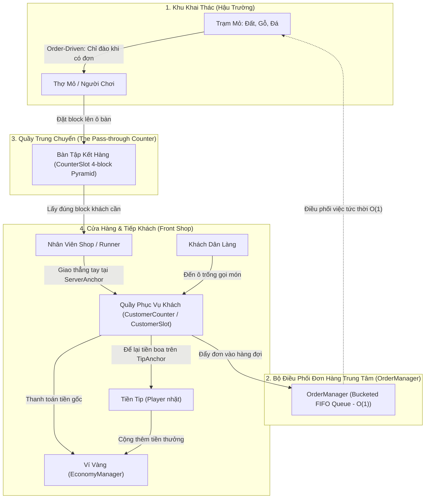
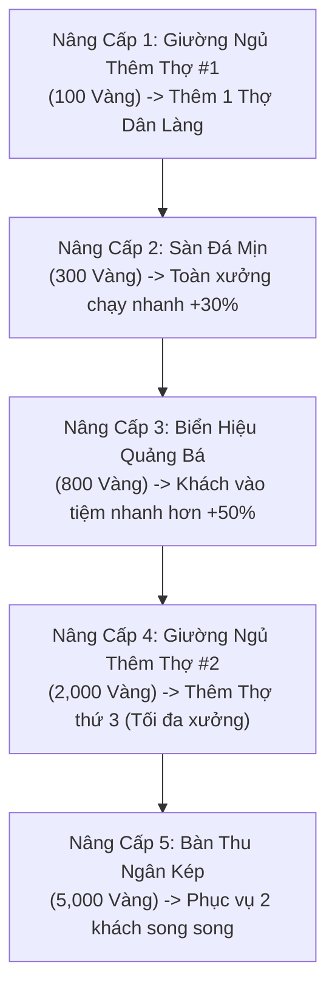

# MineMart: Pocket Workshop — Game Design Document

> **Tài liệu Thiết Kế Trò Chơi (GDD) Quy Chuẩn Công Nghiệp — Quy Mô Màn Hình Đơn (Single-Screen Scoped Edition)**  
> *Được biên soạn theo đề bài nghiên cứu ứng dụng AI, đáp ứng 100% tiêu chí thể loại Incremental/Idle Game, vận hành ngoại tuyến và tối ưu hóa trải nghiệm người dùng.*

---

## 1. Tầm Nhìn & Định Vị Sản Phẩm (Vision & Positioning)

### 1.1 Tuyên Ngôn Dự Án (One-Sentence Pitch)
**MineMart: Pocket Workshop** là tựa game mô phỏng quản lý kinh doanh nhàn rỗi (Single-screen Idle Tycoon) kết hợp điều khiển Arcade trên một màn hình dọc tĩnh, nơi người chơi xây dựng, tự động hóa và tối ưu hóa xưởng chế tác khối vuông (Voxel Block Workshop) phục vụ khách hàng Dân làng (Villagers), mang lại trải nghiệm kinh tế lũy tiến bùng nổ cùng cảm giác tương tác vật lý cực kỳ thỏa mãn (Juicy Feel).

### 1.2 Trụ Cột Trải Nghiệm (Core Pillars)
1. **Tinh Gọn Trong 1 Màn Hình (Single-Screen Completeness)**: Toàn bộ dây chuyền chuỗi cung ứng (Đào mỏ $\rightarrow$ Trung chuyển $\rightarrow$ Phục vụ khách) và dòng tiền hiển thị trực quan trong một góc nhìn Top-Down 2.5D tĩnh duy nhất. Thao tác mượt mà bằng một ngón tay cái, không chuyển cảnh, không gây nhiễu thị giác.
2. **Sự Tương Hỗ Giữa Can Thiệp Tay (Active) & Tự Động (Idle)**: Chế độ can thiệp tay không phải "cho vui" mà mang lại **Giá Trị Thặng Dư Vượt Trội (x2 Tốc Độ Đào, Giải Tỏa Nút Thắt Cổ Chai & Bonus +20% Tiền Tip)**. Người chơi can thiệp để tối đa hóa lợi nhuận thần tốc, buông tay để xưởng tự vận hành ổn định.
3. **Bài Toán Quản Trị Chuỗi Cung Ứng Thực Tế (Supply-Chain Problem Solving)**: Các loại thợ Dân làng được thiết kế với ưu và nhược điểm riêng biệt (Thợ mỏ chỉ đào không bán, Runner chỉ bán không đào). Người chơi liên tục phải đưa ra quyết định: Bố trí lại vị trí quầy, can thiệp khâu nào khi chuyền sản xuất bị nghẽn.

### 1.3 Điểm Bán Hàng Độc Nhất (Unique Selling Propositions - USPs)

| STT | Điểm Bán Hàng Độc Nhất (USP) | Bản Chất & Giá Trị Khác Biệt So Với Thị Trường |
|---|---|---|
| **USP 1** | **Điều Khiển Lai Có Giá Trị Thặng Dư (Hybrid Agency & Active Value)** | Phân định rõ ràng giữa **Pure-Idle (Rảnh tay)** và **Arcade Active (Can thiệp tay)**: Khi người chơi tự điều khiển, nhân vật đóng vai trò là **"Thợ Cả Giải Cứu Nghẽn Hàng"** (Tốc độ đào nhanh gấp đôi thợ thường, có thể giao hàng thẳng nhận tiền tức thì, nhặt tip được bonus thêm +20%). Khi buông tay, hệ thống tự động tiếp quản duy trì nhịp độ cơ bản. |
| **USP 2** | **Bộ Đệm Xếp Chồng Block 3D Chống Nghẽn (Anti-Deadlock Vertical Stacking Buffer)** | Khắc phục hoàn toàn điểm yếu "đĩa thức ăn phẳng" của *Eatventure*. Block thành phẩm ưu tiên dàn đều ô trống; khi hết chỗ sẽ kích hoạt **xếp chồng thẳng đứng thành cột khối 3D (3–5 tầng)**. Vừa giải quyết bài toán nghẽn chuyền sản xuất, vừa tạo hiệu ứng thị giác xưởng hàng tấp nập, hàng hóa đầy ắp. |
| **USP 3** | **Phân Hóa Nhân Sự & Tối Ưu Quy Hoạch Xưởng (Staff Specialization & Spatial Layout)** | Thợ mỏ (Miner) và Nhân viên bồi bàn (Runner) có ưu/khuyết điểm bù trừ lẫn nhau. Kết hợp cơ chế **Kéo thả hoán đổi trạm mỏ (Swap Stations)**, buộc người chơi phải tư duy sắp xếp bố cục xưởng hợp lý để rút ngắn quãng đường di chuyển và giải tỏa các nút thắt cổ chai. |
| **USP 4** | **Kiến Trúc Kinh Tế Độc Lập Ngoại Tuyến (100% Offline Persistence & AFK Engine)** | Cắt bỏ hoàn toàn các rào cản mạng, tài khoản, quảng cáo ép buộc hay nạp tiền. Dữ liệu được bảo toàn tuyệt đối trên máy người chơi với thuật toán tính thu nhập ngoại tuyến (AFK Welcome-Back) công bằng và chính xác. |

---

### 2.1 Sơ Đồ Vận Hành Dây Chuyền Chuỗi Cung Ứng (Supply-Chain Pipeline)



### 2.2 Quy Trình Vòng Đời Đơn Hàng Dây Chuyền (Order Lifecycle Pipeline)
Mỗi chu kỳ phục vụ trong tiệm vận hành theo quy trình phân công lao động khép kín:
1. `CUSTOMER_ORDER`: Khách Dân làng tự tìm ô trống bước tới `CustomerAnchor` tại **Quầy Phục Vụ Khách (`CustomerCounter`)** $\rightarrow$ Đẩy đơn hàng (`OrderTicket`) vào **Bộ Điều Phối Trung Tâm (`OrderManager`)**.
2. `MINING_DISPATCH`: `OrderManager` phân loại đơn vào ngăn FIFO của loại block đó ($O(1)$). Trạm Mỏ tương ứng phát hiện có đơn cần đào (`HasOrderInQueue = true` $\rightarrow$ `NeedsMining = true`). Thợ mỏ / người chơi di chuyển đến mỏ nhận đơn (`ClaimNextOrder`) và đào đúng số lượng được order. Khi không có order, mỏ ở trạng thái IDLE và người chơi di chuyển tự do không bị hút dính.
3. `PASS_THROUGH_DROP`: Thợ mang block đào xong lên **Quầy Trung Chuyển (`CheckoutCounter`)**, đứng ở `PlaceAnchor` đặt vào ô `CounterSlot` phù hợp (xếp kim tự tháp tam giác 4 block).
4. `SHOP_RUNNER_PICKUP`: Nhân viên cửa hàng đến đứng ở `TakeAnchor` quầy trung chuyển rút đúng loại block mà khách đang chờ.
5. `DIRECT_HANDOVER_AND_TIP`: Nhân viên mang block ra đứng ở `ServerAnchor` phía sau ô khách của **Quầy Phục Vụ Khách** trao thẳng tay cho khách $\rightarrow$ `OrderManager` hoàn tất đơn hàng (`CompleteOrder`), bắn sự kiện `OnOrderDelivered` cộng tiền vàng gốc. Khách để lại **Tiền Tip** tại `TipAnchor` trên mặt bàn rồi rời đi, giải phóng ô cho khách tiếp theo. Người chơi chạy qua chạm vào để thu gom tiền tip.

---

## 3. Đặc Tả Cơ Chế Gameplay Chi Tiết (Detailed Gameplay Mechanics)

### 3.1 Hệ Thống Điều Khiển Lai & Hủy Đào Tự Do Kèm Bảo Lưu Tiến Độ (Hybrid Control & Free Cancel with Progress Retention)

Hệ thống điều khiển giải quyết triệt để sự xung đột giữa **Can thiệp tay (Active)** và **Tự động hóa (Idle)**:

#### A. Giá Trị Thặng Dư Của Chế Độ Can Thiệp Tay (Active Value Proposition)
Khi người chơi trực tiếp chạm ngón tay vào màn hình, Cần gạt nổi (**Dynamic Floating Joystick**, bán kính $80\text{px}$, deadzone $15\text{px}$) xuất hiện tức thì tại vị trí chạm:
- **Nhân đôi tốc độ chế tác (x2 Crafting Speed)**: Nhân vật chính đào mỏ nhanh gấp 2 lần thợ AI thông thường (Thời gian đào Đất giảm từ $1.5\text{s} \rightarrow 0.75\text{s}$, Đá từ $8.0\text{s} \rightarrow 4.0\text{s}$).
- **Giải tỏa nút thắt cổ chai (Direct Delivery Breaker)**: Người chơi là nhân vật duy nhất có quyền năng **Làm tắt quy trình** — đào xong mang block chạy thẳng ra trao tận tay cho khách tại Quầy tiếp khách để nhận tiền ngay, không bị phụ thuộc vào Quầy trung chuyển khi quầy đang bị đầy ứ.
- **Thưởng tiền Tip chủ động (+20% Tip Bonus)**: Tiền Tip rơi trên bàn khi người chơi trực tiếp chạy qua chạm vào nhặt sẽ được cộng thêm **+20% giá trị thưởng**.

#### B. Cơ Chế Nam Châm Tiếp Cận & Hủy Đào Tự Do Có Bảo Lưu Tiến Độ (Free Cancel & Progress Retention)
- **Chỉ kích hoạt khi có Order (`NeedsMining = true`)**: Trạm mỏ chỉ mở tương tác khi có khách đang đặt hàng. Khi không có ai order, mỏ ở trạng thái IDLE và người chơi di chuyển tự do ngang qua mỏ mà **tuyệt đối không bị hút dính**.
- **Hút nhẹ tiếp cận (Smart Pop-Snap)**: Khi người chơi tiếp cận mỏ đang có order ($R \le 1.6\text{m}$), nhân vật tự động hút nhẹ vào điểm neo khai thác (`MinerAnchor`), xoay mặt nhìn vào khối mỏ và tự động vung cuốc.
- **Tự do hủy hành động bất kỳ lúc nào (Free Movement Cancel — Giải phóng gò bó)**:
  - **Tuyệt đối không khóa cứng input**: Bất cứ lúc nào người chơi muốn đi phục vụ khách, nhặt tiền tip hay đổi sang mỏ khác, chỉ cần **kéo cần Joystick di chuyển**, nhân vật lập tức buông cuốc và chạy đi ngay lập tức.
- **Bảo lưu tiến độ đào dở dang (`SavedCraftTimer` Retention)**:
  - Khi hành động đào bị ngắt giữa chừng, toàn bộ phần trăm thời gian đã đào (ví dụ đã đào được $5.0\text{s} / 8.0\text{s} = 62.5\%$) được **bảo lưu nguyên vẹn tại khối mỏ**.
  - Khi người chơi hoặc thợ Dân làng quay lại, nhân vật chỉ cần đào nốt phần thời gian còn lại ($3.0\text{s}$) là block văng ra, triệt tiêu hoàn toàn cảm giác ức chế phải đào lại từ đầu.
- **Ngắt an toàn khi Quy hoạch mỏ**: Khi người chơi nhấc mỏ lên để dời vị trí hoặc hoán đổi ô đất, hành động đào cũng tự động ngắt an toàn và bảo lưu tiến độ sang vị trí mới.

#### C. Chế Độ Nhàn Rỗi Tự Động (Auto-Pilot / Pure-Idle)
- Trong menu Cài Đặt có nút **[Bật / Tắt Joystick]**.
- Khi người chơi buông tay khỏi màn hình quá $1.5\text{s}$ (hoặc gạt Tắt Joystick), nhân vật chính tự động kích hoạt chế độ **Auto-Pilot**, tự tìm đến quầy đang có đơn hàng chưa có người nhận để làm việc, duy trì xưởng vận hành liên tục khi người chơi muốn rảnh tay.

```gherkin
Feature: Order-Driven Mining, Free Cancel & Progress Retention
  Scenario: Chạy ngang qua mỏ tự do khi không có Order
    Given trạm Mỏ Đất đã mở khóa nhưng hiện không có khách nào order Đất
    When người chơi điều khiển nhân vật chạy ngang qua Mỏ Đất
    Then nhân vật không bị hút dính vào mỏ và tiếp tục di chuyển tự do

  Scenario: Tự do ngắt đào khi đang cuốc và bảo lưu tiến độ
    Given Quầy Mỏ Đá có thời gian chế tác là 8.0 giây
    And người chơi đang đứng đào mỏ Đá được 5.0 giây (tiến độ đạt 62.5%)
    When người chơi kéo Joystick di chuyển sang vị trí khác để nhặt tiền Tip
    Then nhân vật lập tức buông cuốc và di chuyển tự do ngay tức thì
    And trạm Mỏ Đá bảo lưu tiến độ đào dở dang ở mức 5.0 giây
    When người chơi quay lại trạm Mỏ Đá tiếp tục đào
    Then nhân vật chỉ cần đào thêm 3.0 giây để hoàn thành block Đá
```

---

### 3.2 Hệ Thống Hai Quầy Chuyên Biệt (Pass-through Counter & Customer Counter)

Hệ thống phân tách rạch ròi giữa 2 loại quầy trong tiệm:

#### A. Quầy Trung Chuyển Tiếp Nhận Hàng (The Pass-through Counter — `CheckoutCounter`)
- **Vị trí**: Đặt tại ranh giới ngăn cách giữa Khu Khai Thác (hậu trường) và Khu Cửa Hàng (mặt tiền).
- **Kiến trúc Ô Đặt Hàng Độc Lập (`CounterSlot`)**:
  - Tách rời hoàn toàn thuật toán gom chung của mặt bàn thành từng thực thể **`CounterSlot` độc lập**.
  - **Mỗi ô đặt (Slot)** bao gồm 3 điểm neo:
    - **Điểm neo mặt bàn (`TableAnchor`)**: Nơi chứa đống kim tự tháp tam giác 4 block ($0.4\text{m}$).
    - **Điểm đặt hàng phía sau (`PlaceAnchor` - Phía Mỏ)**: Nơi Thợ Mỏ / Steve đứng đặt block vào ô.
    - **Điểm lấy hàng phía trước (`TakeAnchor` - Phía Shop)**: Nơi Nhân Viên Shop / Steve bốc block ra mang cho khách.
  - **Quản lý phân loại hàng hóa**: Mỗi ô chỉ chứa đồng nhất 1 loại `BlockDataSO` (không để lẫn lộn Đất với Gỗ). Khi ô rỗng, block đầu tiên đặt vào sẽ định hình loại cho ô đó. Khi lấy hết hàng, ô tự reset về rỗng.
  - **Sức chứa Kim Tự Tháp Tam Giác**: Tối đa **4 block / ô** (3 block đáy tam giác phẳng + 1 block đỉnh chóp).
- **Cơ chế tương tác nghiêm ngặt 2 phía**:
  - **Đặt block**: Bắt buộc đứng ở `PlaceAnchor` trước mặt ô đó (`GetSlotAtPlacePosition`).
  - **Lấy block**: Bắt buộc đứng ở `TakeAnchor` trước mặt ô đó (`TryTakeBlockAtTakeAnchor`). Đứng sai phía sẽ không có phản ứng.

#### B. Quầy Phục Vụ Khách Hàng (Customer Service Counter — `CustomerCounter` & `CustomerSlot`)
- **Vị trí**: Đặt tại mặt tiền tiệm tiếp xúc trực tiếp với người mua.
- **Kiến trúc Bàn Dài Nhiều Ô Đón Khách (`CustomerSlot`)**:
  - Hỗ trợ cả bàn đơn lẻ 1 khách lẫn bàn dài mở rộng nhiều vị trí đón khách độc lập (`CustomerSlot[]`).
  - Mỗi ô tiếp khách sở hữu bộ ba điểm neo chuẩn hóa:
    1. **`CustomerAnchor`**: Điểm neo dưới sàn phía trước quầy nơi khách đứng chờ đặt món và nhận hàng.
    2. **`ServerAnchor`**: Điểm neo dưới sàn phía sau quầy nơi nhân viên / người chơi đứng phục vụ riêng cho ô đó. *(Bắt buộc người phục vụ phải đứng ở phía sau quầy, khoảng cách $\le 0.85\text{m}$ tới `ServerAnchor` và gần `ServerAnchor` hơn `CustomerAnchor`. Tuyệt đối không được giao hàng khi đứng ở vị trí của khách).*
    3. **`TipAnchor`**: Điểm neo trên mặt bàn tương ứng với ô đó, nơi tiền tip (tiền boa) xuất hiện sau khi phục vụ xong.
- **Cơ Chế Giao Hàng Thẳng & Sinh Tiền Tip (Direct Handover & Tip Mechanics)**:
  - **Khách hàng (NPC Customer AI)**: Tự động tìm đến ô tiếp khách còn trống (`GetAvailableSlot` / `GetClosestAvailableSlot`) để vào vị trí gọi món.
  - **Giao hàng thẳng**: Nhân viên/Người chơi mang block đúng loại đến đứng tại `ServerAnchor` của ô đó và trao thẳng tay cho khách (`TryDeliverOrderAtPosition`).
  - **Thanh toán tức thì & Sinh Tiền Tip**:
    - Hệ thống bắn sự kiện `OrderDeliveredEventChannelSO` thanh toán tiền giá gốc đơn hàng vào ngân sách.
    - Đồng thời, khách hàng để lại **Tiền Tip (vàng/tiền boa)** xuất hiện ngay tại `TipAnchor` trên mặt bàn của ô đó.
    - Tiền tip nằm chờ trên mặt bàn cho đến khi người chơi chạy qua chạm vào để thu gom (Collect-on-touch), kích hoạt âm thanh leng keng và cộng thêm tiền thưởng vào ví.

```gherkin
Feature: Two-Counter Logistics Pipeline, Direct Handover & Tip Drop
  Scenario: Đặt block phân loại lên Quầy Trung Chuyển từ Phía Đặt
    Given thợ mỏ vừa đào xong 1 Block Đất
    When thợ đứng ở PlaceAnchor (Phía Mỏ) của ô CounterSlot
    Then block được xếp vào ô CounterSlot đang chứa Đất hoặc ô hoàn toàn trống
    And block được xếp theo hình học kim tự tháp tam giác 4 khối

  Scenario: Lấy block từ Quầy Trung Chuyển từ Phía Lấy
    Given ô CounterSlot đang chứa ít nhất 1 Block Đất
    When nhân viên cửa hàng đứng ở TakeAnchor (Phía Shop) của ô đó
    Then 1 block được nhấc lên đầu nhân viên để mang đi phục vụ
    And người đứng ở PlaceAnchor không thể nhấc block

  Scenario: Giao hàng thẳng và sinh Tiền Tip tại Quầy Tiếp Khách
    Given một Khách Dân làng đang đứng chờ nhận Block Đất tại ô CustomerSlot
    When nhân viên mang Block Đất tới đứng đúng ServerAnchor phía sau quầy của ô đó
    Then block được trao thẳng tay cho khách hàng mà không cần đặt lên bàn
    And hệ thống cộng tiền vàng giá gốc đơn hàng vào ví tức thì
    And một bọc Tiền Tip xuất hiện tại TipAnchor trên mặt bàn của ô đó
    And khách hàng rời khỏi ô, giải phóng ô cho khách tiếp theo
```

---

### 3.3 Hệ Thống 3 Quầy Nghề Khối Vuông (Job-Site Stalls Specification)

```
+-----------------------------------------------------------------------------------+
| QUẦY NGHỀ        | ĐỒ NGHỀ | GIÁ MỞ KHÓA          | GIÁ NÂNG CẤP GỐC | T/G GỐC | GIÁ BÁN GỐC   |
+-----------------------------------------------------------------------------------+
| 1. Quầy Đất/Cát  | Xẻng Gỗ | 0 Vàng (Bấm Mở Khóa) | 5 Vàng           | 1.5s    | 1 Vàng / Khối |
| 2. Bàn Chế Tạo Gỗ| Rìu Đá  | 50 Vàng              | 25 Vàng          | 3.5s    | 4 Vàng / Khối |
| 3. Lò Nung Đá    | Cúp Sắt | 500 Vàng             | 120 Vàng         | 8.0s    | 15 Vàng / Khối|
+-----------------------------------------------------------------------------------+
```

> **Cơ Chế Khởi Động Tân Thủ (First-Time User Onboarding)**:  
> Khi bắt đầu game, toàn bộ quầy hàng đều ở trạng thái **Chưa Mở Khóa (Level 0)**. Quầy Đất có giá mở khóa là **0 Vàng**. Người chơi bắt buộc phải thực hiện thao tác tương tác đầu tiên: **Bấm nút Mở Khóa ($0 Vàng)** để quầy trồi lên mặt đất, kích hoạt Level 1 và bắt đầu chu kỳ sản xuất. Thao tác này giúp người chơi hiểu ngay quy tắc cốt lõi: *"Muốn có quầy thì phải đầu tư mở khóa"*.

#### Công Thức Toán Học Kinh Tế Lũy Tiến (Mathematical Balance Formulas)
1. **Giá nâng cấp cấp độ tiếp theo**:
   $$\text{Cost}(L) = \text{BaseUpgradeCost} \times (1.15)^{L - 1}$$
   *(Trong đó $L$ là cấp độ hiện tại của quầy, hệ số tăng giá $1.15$ đảm bảo đường cong độ khó lũy tiến mượt mà).*

2. **Giá trị doanh thu của block thành phẩm**:
   $$\text{Revenue}(L) = \text{BaseRevenue} \times L \times \prod \text{MilestoneMultiplier}$$

---

### 3.4 Bảng Cột Mốc Đột Phá Quầy (Milestone Breakthroughs)
Khi nâng cấp quầy đạt đến các cấp độ cột mốc, hiệu ứng gia tốc đặc biệt được kích hoạt vĩnh viễn cho quầy đó:

| Cột Mốc Level | Hiệu Ứng Thưởng (Breakthrough Buff) | Giá Trị Cảm Xúc & Trải Nghiệm |
|---|---|---|
| **Cấp 10** | **Tăng 25% Tốc Độ Chế Tác** (Thời gian sản xuất $\times 0.8$) | Quầy bắt đầu chạy nhanh rõ rệt, giải tỏa nghẽn hàng ban đầu. |
| **Cấp 25** | **Nhân Đôi Doanh Thu Block (x2 Doanh Thu)** | Cú hích tài chính lớn đầu tiên, tiền nảy vọt giúp mở quầy tiếp theo. |
| **Cấp 50** | **Nhân Đôi Doanh Thu Tiếp Tục (x4 Doanh Thu Tổng)** | Củng cố sức mạnh quầy cũ, bắt kịp tốc độ quầy mới mở. |
| **Cấp 100 (Max)** | **x2 Tốc Độ Chế Tác + x3 Doanh Thu (Đạt Trạng Thái Thần Thánh)** | Quầy hoàn thành chu kỳ tiến hóa, phát hào quang vàng lấp lánh. |

---

### 3.5 Cây Nâng Cấp Xưởng Màn Chơi Bằng Vàng (In-Stage Workshop Upgrades)
Người chơi dùng Tiền Vàng kiếm được từ chính màn chơi để đầu tư vào cơ sở hạ tầng xưởng:



---

### 3.6 Phân Hóa Nhân Sự & Quản Trị Nút Thắt Cổ Chai (Staff Archetypes & Bottleneck Problem Solving)

Game loại bỏ hoàn toàn khái niệm "AI thợ hoàn hảo làm hết mọi việc". Mỗi nhóm nhân sự được thiết kế có **ưu và nhược điểm bù trừ lẫn nhau**, biến xưởng chế tác thành một bài toán quản trị chuỗi cung ứng mà người chơi phải trực tiếp suy nghĩ và can thiệp:

#### A. Bảng Phân Hóa Vai Trò Nhân Sự (Ưu & Nhược Điểm Bù Trừ)

| Nhóm Nhân Sự | Vai Trò & Điểm Mạnh | Khuyết Điểm & Hạn Chế Thiết Kế |
|---|---|---|
| **Thợ Mỏ Dân Làng (Miner)** | • Chuyên tâm khai thác mỏ khi có order.<br/>• Tự động tìm mỏ còn trống gần nhất. | • Tốc độ di chuyển chậm ($2.5\text{ m/s}$).<br/>• **Chỉ biết vác block lên Quầy trung chuyển, tuyệt đối không biết bán hàng cho khách**. |
| **Nhân Viên Shop (Runner)** | • Tốc độ chạy nhanh ($4.0\text{ m/s}$).<br/>• Chuyên trách lấy block từ quầy trung chuyển ra giao cho khách. | • **Tuyệt đối không biết cầm cuốc đào mỏ**.<br/>• Thể lực yếu, chỉ bốc được tối đa 1 block/lần.<br/>• Dễ bị quá tải khi nhiều khách cùng gọi món. |
| **Người Chơi (Shop Owner / Steve)** | • Đa năng toàn diện: vừa đào mỏ, vừa giao hàng.<br/>• Tốc độ đào nhanh gấp đôi ($x2$).<br/>• Có quyền giao hàng thẳng bỏ qua quầy trung chuyển.<br/>• Nhặt tip được thưởng thêm $+20\%$. | • Chỉ có 1 người duy nhất trên sàn, không thể phân thân ở nhiều vị trí cùng lúc.<br/>• Buộc phải liên tục quan sát xưởng để quyết định can thiệp vào khâu nào. |

#### B. Ba Bài Toán Quản Trị Cốt Lõi Người Chơi Phải Giải Quyết (Core Problem Solving)
1. **Bài toán Lệch Pha Cung - Cầu (Asymmetric Production Bottleneck)**:
   - Quầy Đất đào siêu nhanh ($1.5\text{s}$) $\rightarrow$ Dễ làm đầy ứ Quầy trung chuyển ($4\text{ block}$ kim tự tháp). Khi ô quầy bị đầy, Thợ Đất buộc phải đứng chờ, lãng phí nhân công.
   - Quầy Đá đào lâu ($8.0\text{s}$) $\rightarrow$ Khách gọi Đá phải chờ đợi sốt ruột.
   - Một mình Runner không thể vừa bốc giải tỏa quầy Đất vừa chạy đi phục vụ khách gọi Đá $\rightarrow$ **Nút thắt cổ chai xuất hiện!**
   - **Cách giải quyết**: Người chơi phải tự tay lao vào bốc phụ block Đất giao cho khách để giải phóng mặt bàn, hoặc lao vào mỏ Đá đào với tốc độ $x2$ để cứu khách đang chờ.
2. **Bài toán Quy Hoạch Không Gian (Spatial Layout Optimization)**:
   - Tận dụng cơ chế **Kéo thả hoán đổi vị trí mỏ (Swap Stations)**, người chơi phải tính toán:
     - *"Nên đặt mỏ Đất ở gần Quầy trung chuyển để giảm thời gian chạy của Thợ Đất, hay đặt mỏ Đá ở gần để bù lại thời gian đào lâu?"*
     - Bố trí sai vị trí sẽ khiến thợ mất quá nhiều thời gian chạy bộ, làm giảm $30 - 40\%$ tổng doanh thu toàn xưởng.
3. **Quyết Định Đầu Tư Nâng Cấp Đúng Thời Điểm**:
   - Khi xưởng ứ đọng hàng: Ưu tiên mua thêm **Giường Ngủ** để tuyển thêm Runner, thay vì tiếp tục nâng cấp cấp độ quầy mỏ làm hàng tràn ra nhiều hơn.

#### C. Thuật Toán Điều Phối & Di Chuyển Xuyên Thấu (Autonomous Dispatcher)
- **Hàng đợi đơn hàng trung tâm (FIFO $O(1)$)**: Phân phối đơn hàng công bằng cho các thợ rảnh việc.
- **Phá vỡ thế cân bằng (Distance Tie-breaker)**: Thợ tự động chọn trạm mỏ ở cự ly gần nhất tính theo khoảng cách Euclid để tối ưu hóa quãng đường.
- **Di chuyển xuyên thấu (Pass-through Agents)**: Toàn bộ Dân làng và người chơi sử dụng Layer vật lý không va chạm lẫn nhau (Zero Character Collision), triệt tiêu hoàn toàn lỗi kẹt góc hay tắc đường thường gặp trong game mô phỏng.

---

## 4. Kiến Trúc Cơ Sở Dữ Liệu & Lưu Trữ Cục Bộ (Database & Persistence)

Hệ thống dữ liệu của **MineMart: Pocket Workshop** tuân thủ nguyên tắc phân định rạch ròi thành **3 Trụ Cột Độc Lập**, bảo đảm tính toàn vẹn dữ liệu ngoại tuyến 100%:

```
                          HỆ THỐNG DỮ LIỆU CỦA MINEMART
                                        |
      +---------------------------------+---------------------------------+
      |                                 |                                 |
 [NHÓM 1: CONFIG DATA]        [NHÓM 2: GLOBAL PROFILE]        [NHÓM 3: STAGE STATE]
"Quy định gốc của game"       "Tài sản & Cài đặt vĩnh viễn"   "Tiến trình xưởng hiện tại"
(ScriptableObjects - Tĩnh)   (Save JSON - Bền vững)          (Save JSON - Reset theo màn)
```

### 4.1 Nhóm 1: Config Data (Dữ Liệu Cấu Hình Tĩnh — ScriptableObjects)
*Được biên soạn bởi Game Designer, chỉ đọc trong thời gian chạy (Read-Only).*

1. **`stallStartStatsManager` (Chỉ số xuất phát của từng quầy)**:
   - `id_Stall` (string): Định danh duy nhất (`"stall_dirt"`, `"stall_wood"`, `"stall_stone"`).
   - `stall_Name` (string): Tên tiếng Việt hiển thị trên UI.
   - `stall_buy_prices` (double): Giá mua mở quầy ban đầu.
   - `stall_Start_Upgrade_Prices` (double): Giá nâng cấp từ Lv 1 lên Lv 2.
   - `stall_Start_generated_ore_timer` (float): Thời gian sản xuất gốc (giây).
   - `base_ore_value` (double): Giá bán cơ bản của block.
   - `milestone_rules` (List): Danh sách cấu hình mốc thưởng Lv 10, 25, 50, 100.
2. **`workshopUpgradeConfig` (Cấu hình Cây nâng cấp xưởng)**:
   - ID nâng cấp, Tên, Giá mua bằng Vàng, Loại hiệu ứng (`AddWorker`, `SpeedBuff`, `SpawnBuff`, `DoubleRegister`).

### 4.2 Nhóm 2 & 3: Save Data (Dữ Liệu Người Chơi — `savegame.json`)
Lưu trữ cục bộ tại đường dẫn bảo mật của hệ điều hành (`Application.persistentDataPath/savegame.json`):

```json
{
  "saveVersion": 1,
  "lastOfflineTimestamp": 1727180000,

  "globalProfile": {
    "settings": {
      "isJoystickEnabled": true,
      "isHapticsEnabled": true,
      "masterVolume": 0.8,
      "sfxVolume": 1.0
    }
  },

  "currentStage": {
    "stageId": "stage_01_pocket_workshop",
    "stageGold": "18450",
    "stallManagerMap": [
      { "id_stall": "stall_dirt", "stall_Unlocked": true, "stall_level": 50 },
      { "id_stall": "stall_wood", "stall_Unlocked": true, "stall_level": 25 },
      { "id_stall": "stall_stone", "stall_Unlocked": true, "stall_level": 8 }
    ],
    "stageUpgradesPurchased": [
      "upgrade_bed_1",
      "upgrade_smooth_stone_floor",
      "upgrade_shop_sign"
    ]
  }
}
```

### 4.3 Cơ Chế Tự Động Lưu & Thu Nhập Ngoại Tuyến (Persistence & AFK Engine)
- **Tần suất tự động lưu (Auto-save)**:
  - Lưu ngầm định kỳ mỗi **30 giây** một lần.
  - Lưu khẩn cấp ngay khi ứng dụng bị ẩn hoặc tắt: bắt sự kiện `OnApplicationPause(true)` và `OnApplicationQuit()`.
- **Thuật toán tính tiền vắng mặt (Offline AFK Calculation)**:
  - Khi mở game, lấy thời gian thực thiết bị: $\Delta t = \text{currentTime} - \text{lastOfflineTimestamp}$.
  - Giới hạn thời gian tích lũy tối đa trong bản MVP: $T_{\max} = 7200\text{ giây (2 giờ)}$.
  - $\Delta t_{\text{valid}} = \min(\Delta t, T_{\max})$.
  - Công thức tính tiền thưởng:
    $$\text{AFKEarnings} = \Delta t_{\text{valid}} \times \sum_{i=1}^{n} \left(\frac{\text{Revenue}_i}{\text{CraftTime}_i} \times 0.5\right)$$
    *(Nhân hệ số $0.5$ để cân bằng kinh tế, khuyến khích người chơi tương tác trực tiếp).*
  - Hiển thị bảng thông báo Popup chào đón: *"Chào mừng bạn trở lại xưởng! Trong lúc bạn vắng mặt, các thợ Dân làng đã kiếm được +X Vàng!"*.

---

## 5. Bố Cục Giao Diện Màn Hình Đơn (Single-Screen UI / Wireframe)

Giao diện được thiết kế tối ưu cho tỉ lệ màn hình dọc 9:16 trên thiết bị di động, thao tác hoàn toàn bằng một ngón tay cái:

```
+-------------------------------------------------------------------+
|  [ VÀNG: 18,450 G ]                  [ CÀI ĐẶT: ⚙️ (Joy/Rung) ]   |  <- Top Bar (Header)
+-------------------------------------------------------------------+
|                                                                   |
|             [ CỬA VÀO - KHÁCH DÂN LÀNG ĐẾN ]                      |
|                            |                                      |
|                  [ QUẦY THU NGÂN & BUFFER ]                       |
|                 [Cọc Đất]  [Cọc Gỗ]  [Cọc Đá]                     |
|                                                                   |
|   +-----------------+  +-----------------+  +-----------------+   |
|   |  QUẦY 1: ĐẤT    |  |  QUẦY 2: GỖ     |  |  QUẦY 3: ĐÁ     |   |  <- Sàn Thao Tác
|   |  [Xẻng Gỗ]      |  |  [Rìu Đá]       |  |  [Cúp Sắt]      |   |     (Top-Down 2.5D)
|   |  Thợ Dân Làng #1|  |  Thợ Dân Làng #2|  |  Thợ Dân Làng #3|   |
|   +-----------------+  +-----------------+  +-----------------+   |
|                                                                   |
|                    ( Khu Vực Joystick Nổi )                       |
|                                                                   |
+-------------------------------------------------------------------+
|  [TAB: NÂNG CẤP QUẦY (3)]        |  [TAB: CẢI TẠO XƯỞNG (5)]      |  <- Bottom Tabs
|-------------------------------------------------------------------|
| [QUẦY ĐẤT] Lv.50/100 | Nâng cấp: 450 G  | [ NÂNG CẤP (UPGRADE) ]  |
| [QUẦY GỖ]  Lv.25/100 | Nâng cấp: 1,200 G| [ NÂNG CẤP (UPGRADE) ]  |  <- Footer Control
| [QUẦY ĐÁ]  Lv.8/100  | Nâng cấp: 3,500 G| [ NÂNG CẤP (UPGRADE) ]  |     (Scrollable List)
+-------------------------------------------------------------------+
```

---

## 6. Kịch Bản Kiểm Thử Chấp Nhận Hệ Thống (Acceptance Test Scenarios / Gherkin)

```gherkin
Feature: Single-Screen Incremental Core Loop & Payout
  Scenario: Chế tác hoàn thành và thanh toán nhận tiền
    Given Quầy Khai Thác Đất đang hoạt động và có 1 đơn hàng chờ
    When thanh thời gian chế tác hoàn thành chu kỳ 1.5 giây
    Then một khối Block Đất được sinh ra và đưa vào khay đệm
    And khách hàng Dân làng nhận block, để lại tiền vàng trên sàn
    And tài khoản Tiền Vàng của người chơi tăng đúng giá trị block

  Scenario: Nâng cấp quầy đạt cột mốc đột phá x2 doanh thu
    Given Quầy Gỗ đang ở Level 24 và giá nâng cấp là 500 Vàng
    And người chơi có số dư 1,000 Vàng trong ví
    When người chơi bấm nút "Nâng Cấp" trên quầy Gỗ
    Then Level Quầy Gỗ tăng lên 25
    And số dư ví Vàng giảm 500
    And kích hoạt mốc Milestone Level 25: giá bán Block Gỗ nhân đôi (x2 Revenue)
    And hiệu ứng pháo hoa tia sáng bùng nổ tại vị trí quầy Gỗ

  Scenario: Tự động lưu tiến trình và tính tiền nhàn rỗi ngoại tuyến
    Given người chơi thoát game khi xưởng đang có 3 quầy hoạt động
    And thời gian vắng mặt thực tế là 3,600 giây (1 giờ)
    When người chơi khởi động lại game
    Then hệ thống đọc file savegame.json thành công
    And hiển thị bảng Popup thông báo tiền tích lũy AFK trong 1 giờ
    And cộng toàn bộ số tiền vàng nhàn rỗi vào tài khoản của người chơi
```

---

## 7. Phụ Lục: Trích Lục Nhật Ký Tương Tác & Đồng Sáng Tạo Cùng AI (Human-AI Co-Creation Log)

> **Tuyên ngôn phương pháp luận (Self-Contained Academic & Production Proof)**:  
> Mục này đóng vai trò là **bằng chứng thực nghiệm khép kín** minh chứng cho quá trình nghiên cứu, phản biện và đồng thiết kế giữa **Tác giả (Miyuki / Lâm Tuyết Nhi)** và **Trợ lý Trí tuệ nhân tạo (AI Game Designer)**.  
> Toàn bộ các trích đoạn đối thoại dưới đây là **nguyên văn câu lệnh (Raw Prompts)** và phản hồi thực tế trong quá trình xây dựng dự án, khẳng định vai trò làm chủ tư duy, định hướng bài toán của con người kết hợp cùng năng lực mô hình hóa, chuẩn hóa của AI.

---

### 7.1 Nguyên Tắc Phân Định Trách Nhiệm (Human-in-the-Loop Framework)

```
+-----------------------------------------------------------------------------------+
|                        QUY TRÌNH ĐỒNG THIẾT KẾ (PAIR-DESIGN)                      |
+-----------------------------------------------------------------------------------+
| 1. CON NGƯỜI (Tác giả Miyuki) : Khởi tạo ý tưởng cốt lõi & Nhận diện rủi ro       |
|                                 (Product Owner / Creative Lead)                   |
|                                       │                                           |
|                                       ▼                                           |
| 2. TRỢ LÝ AI (AI Designer)    : Phân tích cơ chế, thiết lập công thức toán học    |
|                                 và chuẩn hóa sơ đồ nghiệp vụ                      |
|                                       │                                           |
|                                       ▼                                           |
| 3. CON NGƯỜI (Tác giả Miyuki) : Phản biện, thanh lọc tính năng & Phê duyệt GDD    |
+-----------------------------------------------------------------------------------+
```

---

### 7.2 Trích Lục Đối Thoại Thực Tế & Quyết Định Thiết Kế (Prompt-Driven Transcripts)

*(Dưới đây là các mốc trao đổi mang tính bước ngoặt cấu thành trực tiếp nên các cơ chế trong bản GDD_MVP này)*

#### 📌 Mốc 1: Khởi Tạo Đề Tài & Phân Rã Đối Thủ (*Eatventure*)
- **Nguyên văn câu lệnh của Tác giả (Prompt)**:
  > *"1 em muốn lấy chủ đề cho game dựa trên một con game khá nổi tiếng là minecraft (kiểu thay vì các quán ăn thì sẽ là các cửa hàng bán theo các block được phân loại theo từng chủ đề của cửa hàng)... 3 có thể thực thi nhưng tạm thời chưa code vội, chúng ta cùng ngồi phân rã điểm mạnh và điểm yếu của con game eatventure để tối ưu những điểm yếu và tăng cường những điểm mạnh"*
- **Phản hồi & Đóng góp của AI**: Phân tích điểm nghẽn "đĩa phẳng" của *Eatventure* (dễ tràn hàng gây tắc nghẽn dây chuyền) và đề xuất cơ chế sản xuất chỉ kích hoạt khi có đơn đặt hàng từ khách.
- **Quyết định định hình trong GDD_MVP**: **Mục 1.1 & 1.2** — Xác lập thể loại Single-screen Voxel Idle Tycoon kết hợp Arcade, lấy chủ đề xưởng chế tác khối vuông phục vụ khách hàng Dân làng.

---

#### 📌 Mốc 2: Kiến Trúc Thợ Dân Làng & Xử Lý Va Chạm (Pass-through)
- **Nguyên văn câu lệnh của Tác giả (Prompt)**:
  > *"là một người chơi minecraft lâu năm như em, dân làng nên làm thành nhân viên thay vì là khách hàng... bài toán rất tốt, em có thêm một gợi ý nhỏ là cho phép các dân làng đi xuyên qua nhau, mỗi một quầy sau khi nâng cấp sẽ có thêm một block nghề để dân làng đến làm việc, quan trọng nhất là dân làng không sinh ra theo block nghề mà số lượng dân làng cũng nằm trong tiến trình nâng cấp"*
- **Phản hồi & Đóng góp của AI**: Thiết kế mô hình Trạm nghề đa vị trí (Multi-slot Job-site Workstation) và cơ chế không va chạm vật lý (Zero Character Collision / Layer Mask Bypass) để triệt tiêu hoàn toàn lỗi kẹt góc khi xưởng đông đúc.
- **Quyết định định hình trong GDD_MVP**: **Mục 1.3 (USP 3) & Mục 3.6** — Thuật toán Autonomous Task Dispatcher điều phối thợ theo FIFO + Khoảng cách gần nhất, nhân vật đi xuyên qua nhau, nâng cấp tuyển thợ thông qua nhánh Giường ngủ.

---

#### 📌 Mốc 3: Đột Phá Cơ Chế Điều Khiển Lai (Hybrid Control)
- **Nguyên văn câu lệnh của Tác giả (Prompt)**:
  > *"sẽ ra sao nếu thêm 1 USP nữa là có cả auto và có cả control... trước khi quyết định về hướng control của nhân vật, em muốn hỏi thiết kế game màn hình ngang hay dọc thì hợp lí hơn?... vậy theo chị joystick 4 nút hay joystick tròn?"*
- **Phản hồi & Đóng góp của AI**: Đề xuất cơ chế điều khiển lai: Buông tay = Auto-Pilot (siêu thợ tự động); Chạm tay = Cần gạt nổi (Dynamic Floating Joystick 360 độ). Phân tích lợi thế màn hình dọc 9:16 tối ưu cho ngón tay cái khi chơi casual.
- **Quyết định định hình trong GDD_MVP**: **Mục 1.3 (USP 1), Mục 3.1 & Mục 5** — Đặc tả hệ thống Hybrid Control (vận tốc 4.5m/s, bán kính 80px), cơ chế nam châm hút Pop-Snap khi mỏ có order và bố cục màn hình dọc 1 tay.

---

#### 📌 Mốc 4: Quản Trị Rủi Ro & Chiến Lược Cắt Gọt Phạm Vi (Scope Scoping)
- **Nguyên văn câu lệnh của Tác giả (Prompt)**:
  > *"được rồi, giờ quay lại ván cờ thực tế, unity không thể import model của blockbench, cũng như không tránh khỏi việc mình sẽ bị gán mác game fake minecraft, thời gian thực hiện dự án có hạn do lịch thời gian biểu cũng như là các vấn đề sức khỏe và tâm lý, vậy rủi ro lớn nhất của dự án này là gì"*
- **Phản hồi & Đóng góp của AI**: Cảnh báo rủi ro lớn nhất là "quá tải tính năng" (Scope Creep) dẫn đến đứt gãy tiến độ. Đề xuất chiến lược giải cứu: Cắt bỏ toàn bộ các tính năng mở rộng dài hạn (nhiều biome, đồ bộ RPG phức tạp), dồn toàn lực hoàn thiện xuất sắc bản **Single-Screen Scoped MVP**.
- **Quyết định định hình trong GDD_MVP**: **Mục 3.3** — Cô đọng vòng lặp sản xuất vào đúng 3 Quầy nghề cơ bản (Đất, Gỗ, Đá) trên một mặt phẳng duy nhất, bảo đảm 100% tính khả thi nghiệm thu đúng hạn.

---

#### 📌 Mốc 5: Bộ Đệm Xếp Chồng 3D Chống Nghẽn (Vertical Stacking)
- **Nguyên văn câu lệnh của Tác giả (Prompt)**:
  > *"trong lúc chơi eatventure, em còn để ý đến một chi tiết, trong những map có nhiều mặt hàng hóa và có ít ô để hàng ở quầy thì game cho phép hàng hóa này đè lên hàng hóa khác (miễn là trong 1 ô không bị trùng loại mặt hàng)"*
- **Phản hồi & Đóng góp của AI**: Chuẩn hóa thành cơ chế Bộ đệm xếp chồng khối hộp 3D theo cấu trúc Kim tự tháp tam giác 4 block ($0.4\text{m}$) trên mỗi ô `CounterSlot`, tối ưu hóa hiệu ứng thị giác xưởng hàng đầy ắp.
- **Quyết định định hình trong GDD_MVP**: **Mục 1.3 (USP 2) & Mục 3.2.A** — Kiến trúc Quầy trung chuyển `CheckoutCounter` với các ô đệm 4 block đồng nhất loại.

---

#### 📌 Mốc 6: Chuẩn Hóa Chuỗi Cung Ứng & Kiến Trúc Trung Gian (Event Channels)
- **Nguyên văn câu lệnh của Tác giả (Prompt)**:
  > *"nhưng xác định lại flow core loop 1 chút: khách hàng vào tiệm -> một nhân viên đang idle -> đến nhận order của khách -> nhân viên đi lấy hàng hoặc khai thác hàng -> mang ra đưa cho khách... và code thì luôn thông qua trung gian chứ không trực tiếp cộng tiền trong code giao hàng cho khách"*
- **Phản hồi & Đóng góp của AI**: Dựng sơ đồ chuỗi cung ứng khép kín 5 bước. Thiết lập nguyên tắc Event-Driven SO: Khi giao hàng chỉ phát sự kiện `OnOrderDelivered`, hệ thống `EconomyManager` độc lập đón nhận sự kiện để cộng tiền, tránh coupling mã nguồn.
- **Quyết định định hình trong GDD_MVP**: **Mục 2.1, Mục 2.2 & Mục 4.1** — Sơ đồ luồng đơn hàng dây chuyền và mô hình quản lý dữ liệu tĩnh bằng ScriptableObjects.

---

#### 📌 Mốc 7: Lượt Phản Biện Chuyên Môn & Hoàn Thiện Triết Lý Game Design (Mentor Feedback Iteration)
- **Phản biện từ Giảng viên / Chuyên gia (Mentor Review)**:
  > *"1. Việc người chơi bắt tay vào điều khiển nhân vật có tạo ra giá trị đặc biệt gì hơn Auto? Nếu không tạo ra sự khác biệt người dùng sẽ nhanh chán... 2. Cơ chế khóa chân khi đào gây cảm giác gò bó... 3. Đối với worker, đừng cố làm nó thông minh nhất có thể. Game tạo ra là để người chơi giải quyết vấn đề. Hãy làm cho worker có hạn chế để người dùng suy nghĩ sắp xếp..."*
- **Giải pháp & Quyết định tinh chỉnh của Tác giả cùng AI (Iterative Design)**:
  1. *Làm rõ giá trị thặng dư của Active Play*: Nhân vật người chơi được cấp quyền năng "Thợ Cả" (Tốc độ đào nhanh $x2$, có thể giao thẳng hàng bỏ qua quầy trung chuyển, nhặt tip được bonus $+20\%$).
  2. *Giải phóng gò bó di chuyển*: Loại bỏ hoàn toàn cơ chế khóa cứng input khi đào mỏ. Chuyển thành cơ chế **Hủy đào tự do kèm Bảo lưu tiến độ (`Progress Retention`)** — người chơi kéo Joystick là hủy ngay tức thì, tiến độ % đào dở được lưu lại trên khối mỏ.
  3. *Phân hóa khuyết điểm nhân sự*: Chia ranh giới nghiêm ngặt giữa Thợ Mỏ (chỉ đào không bán) và Runner (chỉ bán không đào), tạo ra bài toán lệch pha cung - cầu và bài toán quy hoạch không gian (Swap Plots) buộc người chơi phải liên tục tư duy điều phối.
- **Quyết định định hình trong GDD_MVP**: **Mục 1.2, Mục 1.3 (USP 1 & 3), Mục 3.1 & Mục 3.6**.

---

### 7.3 Đánh Giá Giá Trị Gia Tăng Từ Việc Ứng Dụng AI
1. **Đối với Tác giả**: Giúp một nhà phát triển độc lập (Solo Developer) giải tỏa áp lực về tính toán công thức kinh tế, quy chuẩn hóa tài liệu chuyên nghiệp và sở hữu một đối tác phản biện đa chiều (đóng vai người chơi, nhà đầu tư) ngay trong quá trình lên ý tưởng.
2. **Đối với Sản phẩm**: Rút ngắn thời gian từ ý tưởng thô đến bản đặc tả kỹ thuật khả thi từ vài tuần xuống còn vài ngày, loại bỏ các lỗi thiết kế hệ thống nghiêm trọng (như deadlock chuyền hàng hay coupling mã nguồn) ngay từ khâu thiết kế trên giấy.
3. **Tính thích ứng qua các vòng lặp (Feedback Agility)**: Thể hiện khả năng tiếp thu phản biện chuyên môn từ Giảng viên/Chuyên gia một cách nhanh chóng, sử dụng AI để phân tích và chuẩn hóa lại tài liệu chỉ trong vài giờ làm việc.

---

*Hết tài liệu Game Design Document.*


