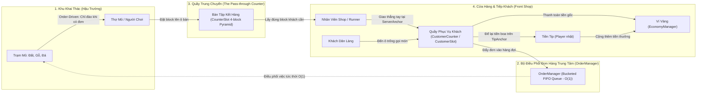
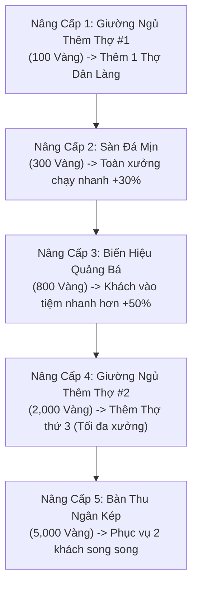

# MineMart: Pocket Workshop — Game Design Document

> **Tài liệu Thiết Kế Trò Chơi (GDD) Quy Chuẩn Công Nghiệp — Quy Mô Màn Hình Đơn (Single-Screen Scoped Edition)**  
> *Được biên soạn theo đề bài nghiên cứu ứng dụng AI, đáp ứng 100% tiêu chí thể loại Incremental/Idle Game, vận hành ngoại tuyến và tối ưu hóa trải nghiệm người dùng.*

---

## 1. Tầm Nhìn & Định Vị Sản Phẩm (Vision & Positioning)

### 1.1 Tuyên Ngôn Dự Án (One-Sentence Pitch)
**MineMart: Pocket Workshop** là tựa game mô phỏng quản lý kinh doanh nhàn rỗi (Single-screen Idle Tycoon) kết hợp điều khiển Arcade trên một màn hình dọc tĩnh, nơi người chơi xây dựng, tự động hóa và tối ưu hóa xưởng chế tác khối vuông (Voxel Block Workshop) phục vụ khách hàng Dân làng (Villagers), mang lại trải nghiệm kinh tế lũy tiến bùng nổ cùng cảm giác tương tác vật lý cực kỳ thỏa mãn (Juicy Feel).

### 1.2 Trụ Cột Trải Nghiệm (Core Pillars)
1. **Tinh Gọn Trong 1 Màn Hình (Single-Screen Completeness)**: Toàn bộ vòng lặp sản xuất, vận chuyển, nâng cấp và dòng tiền diễn ra liền mạch trong một góc nhìn Top-Down 2.5D tĩnh duy nhất. Không chuyển cảnh, không tải map, không phân tán sự tập trung.
2. **Tiến Trình Lũy Tiến Gây Nghiện (Exponential Dopamine Curve)**: Công thức tăng giá và mốc nhân đột phá (Milestone Multipliers x2, x4, x10) tạo ra những cú hích doanh thu rõ rệt, biến từng đồng tiền lẻ ban đầu thành dòng tiền triệu vàng cuồn cuộn.
3. **Phản Hồi Giác Quan Đậm Đặc (Juicy Micro-interactions)**: Áp dụng triệt để "Quy tắc Số Ba" (Rule of Three) — mọi cú chạm tay, khối quặng nảy, block xếp chồng và tiếng leng keng của tiền xu đều mang lại khoái cảm thính giác và xúc giác tối đa.

### 1.3 Điểm Bán Hàng Độc Nhất (Unique Selling Propositions - USPs)

| STT | Điểm Bán Hàng Độc Nhất (USP) | Bản Chất & Giá Trị Khác Biệt So Với Thị Trường |
|---|---|---|
| **USP 1** | **Cơ Chế Điều Khiển Lai Kèm Chuyển Đổi Linh Hoạt (Hybrid Control with Mode Toggle)** | Kết hợp hoàn hảo giữa **Pure-Idle (Rảnh tay 100%)** và **Arcade Active Play (Can thiệp tay)**. Người chơi có thể buông máy để game tự chạy, hoặc kéo Cần gạt nổi (Floating Joystick) để trực tiếp lao vào xưởng tăng gấp đôi tốc độ. Đặc biệt có **nút Bật/Tắt Joystick trong Cài đặt** cho phép người chơi tùy biến phong cách chơi theo ý muốn. |
| **USP 2** | **Bộ Đệm Xếp Chồng Block 3D Chống Nghẽn (Anti-Deadlock Vertical Stacking Buffer)** | Khắc phục hoàn toàn điểm yếu "đĩa thức ăn phẳng" của *Eatventure*. Block thành phẩm ưu tiên dàn đều ô trống; khi hết chỗ sẽ kích hoạt **xếp chồng thẳng đứng thành cột khối 3D (3–5 tầng)**. Vừa giải quyết bài toán nghẽn chuyền sản xuất, vừa tạo hiệu ứng thị giác xưởng hàng tấp nập, hàng hóa đầy ắp. |
| **USP 3** | **Thuật Toán Điều Phối Thợ Dân Làng Tối Ưu (Autonomous Task Dispatcher)** | Trí tuệ nhân tạo của Dân làng vận hành theo thuật toán kết hợp **FIFO (Đơn đến trước làm trước) + Distance Tie-breaker (Khoảng cách gần nhất)**. Nhân vật có cơ chế đi xuyên nhau (Pass-through) loại bỏ hoàn toàn tình trạng kẹt đường vật lý. |
| **USP 4** | **Kiến Trúc Kinh Tế Độc Lập Ngoại Tuyến (100% Offline Persistence & AFK Engine)** | Cắt bỏ hoàn toàn các rào cản mạng, tài khoản, quảng cáo ép buộc hay nạp tiền. Dữ liệu được bảo toàn tuyệt đối trên máy người chơi với thuật toán tính thu nhập ngoại tuyến (AFK Welcome-Back) công bằng và chính xác. |

---

### 2.1 Sơ Đồ Vận Hành Dây Chuyền Chuỗi Cung Ứng (Supply-Chain Pipeline)



### 2.2 Quy Trình Vòng Đời Đơn Hàng Dây Chuyền (Order Lifecycle Pipeline)
Mỗi chu kỳ phục vụ trong tiệm vận hành theo quy trình phân công lao động khép kín:
1. `CUSTOMER_ORDER`: Khách Dân làng tự tìm ô trống bước tới `CustomerAnchor` tại **Quầy Phục Vụ Khách (`CustomerCounter`)** $\rightarrow$ Đẩy đơn hàng (`OrderTicket`) vào **Bộ Điều Phối Trung Tâm (`OrderManager`)**.
2. `MINING_DISPATCH`: `OrderManager` phân loại đơn vào ngăn FIFO của loại block đó ($O(1)$). Trạm Mỏ tương ứng phát hiện có đơn cần đào (`HasOrderInQueue = true` $\rightarrow$ `NeedsMining = true`). Thợ mỏ / người chơi di chuyển đến mỏ nhận đơn (`ClaimNextOrder`) và đào đúng số lượng được order. Khi không có order, mỏ ở trạng thái IDLE và người chơi di chuyển tự do không bị hút dính.
3. `PASS_THROUGH_DROP`: Thợ mang block đào xong lên **Quầy Trung Chuyển (`CheckoutCounter`)**, đứng ở `PlaceAnchor` đặt vào ô `CounterSlot` phù hợp (xếp kim tự tháp tam giác 4 block).
4. `SHOP_RUNNER_PICKUP`: Nhân viên cửa hàng đến đứng ở `TakeAnchor` quầy trung chuyển rút đúng loại block mà khách đang chờ.
5. `DIRECT_HANDOVER_AND_TIP`: Nhân viên mang block ra đứng ở `ServerAnchor` phía sau ô khách của **Quầy Phục Vụ Khách** trao thẳng tay cho khách $\rightarrow$ `OrderManager` hoàn tất đơn hàng (`CompleteOrder`), bắn sự kiện `OnOrderDelivered` cộng tiền vàng gốc. Khách để lại **Tiền Tip** tại `TipAnchor` trên mặt bàn rồi rời đi, giải phóng ô cho khách tiếp theo. Người chơi chạy qua chạm vào để thu gom tiền tip.

---

## 3. Đặc Tả Cơ Chế Gameplay Chi Tiết (Detailed Gameplay Mechanics)

### 3.1 Hệ Thống Điều Khiển Lai & Hút Nam Châm Khóa Chân (Hybrid Control & Pop Snap)
- **Cơ chế Cần Gạt Nổi (Dynamic Floating Joystick)**:
  - Khi chạm ngón tay vào bất kỳ điểm nào trên nửa dưới màn hình, tâm Joystick tự động định vị tại đó (Dynamic Origin).
  - Bán kính nhận diện: $80\text{px}$, vùng đệm chết (Deadzone): $15\text{px}$.
  - Tốc độ di chuyển nhân vật chính: $4.5\text{ m/s}$.
- **Cơ chế Hút Dứt Khoát & Khóa Cứng Đào Mỏ (Magnet Pop-Snap & Mining Action Lock)**:
  - **Chỉ đào khi có Order**: Trạm mỏ chỉ mở tương tác và kích hoạt hút khi khách hàng đang có đơn hàng chờ loại block đó (`NeedsMining = true`). Khi không có ai order, mỏ ở trạng thái IDLE và người chơi di chuyển tự do ngang qua mỏ mà **tuyệt đối không bị hút dính hay khóa chân**.
  - **Hút Dứt Khoát (Pop Snap)**: Khi người chơi tay trống tiếp cận mỏ đang có order ($R \le 1.6\text{m}$), nhân vật lập tức bị hút dứt khoát "póc" một cái vào đúng điểm neo khai thác (`MinerAnchor`), xoay mặt nhìn thẳng vào khối mỏ, kích hoạt hiệu ứng Squash & Stretch ($0.16\text{s}$) nảy đàn hồi tạo cảm giác dính cộp như nam châm.
  - **Khóa Cứng Hành Động (Action Freeze/Lock)**: Trong suốt quá trình khai thác (`MiningTimer < BaseCraftTime`), toàn bộ input di chuyển bị vô hiệu hóa và vị trí nhân vật được giữ chặt tại điểm neo. Không cho phép di chuyển lết thết hay vừa đi vừa đào.
  - **Mở Khóa Tự Động (Auto Unlock on Harvest)**: Ngay khi khối block khai thác xong và nảy lên đỉnh đầu (`CarryAnchor`, kích thước $0.4\text{m}$), hệ thống lập tức mở khóa di chuyển, trừ 1 đơn pending để người chơi tự do mang hàng ra quầy hoặc trao thẳng cho khách.
- **Tùy Chọn Chuyển Đổi Trong Cài Đặt (Settings Toggle)**:
  - Trong menu Cài Đặt có nút: **[Bật / Tắt Joystick]** (`isJoystickEnabled`).
  - **Khi TẮT**: Toàn bộ hệ thống Joystick bị vô hiệu hóa. Nhân vật chính tự động chuyển thành một **Thợ Siêu Cấp Tự Hành (Autonomous Super-Worker)**, tự động tìm đến quầy có giá trị cao nhất hoặc quầy đang bị ứ đọng để hỗ trợ.

```gherkin
Feature: Order-Driven Mining & Magnet Pop-Snap with Action Lock
  Scenario: Chạy ngang qua mỏ tự do khi không có Order
    Given trạm Mỏ Đất đã mở khóa nhưng hiện không có khách nào order Đất
    When người chơi điều khiển nhân vật chạy ngang qua Mỏ Đất
    Then nhân vật không bị hút dính vào mỏ và tiếp tục di chuyển tự do

  Scenario: Hút dứt khoát và khóa cứng di chuyển khi có Order cần đào
    Given có khách hàng đang chờ đơn Block Đất tại Quầy Tiếp Khách
    When nhân vật bước vào bán kính tương tác của Mỏ Đất
    Then nhân vật bị hút dứt khoát "póc" vào đúng điểm neo MinerAnchor
    And input di chuyển bị khóa cứng hoàn toàn trong suốt thời gian đào
    And khi đào xong, block được nhấc lên đầu, 1 order được tiêu thụ và mở khóa di chuyển
```

---

### 3.2 Hệ Thống Hai Quầy Chuyên Biệt (Pass-through Counter & Customer Counter)

Hệ thống phân tách rạch ròi giữa 2 loại quầy trong tiệm:

#### A. Quầy Trung Chuyển Tiếp Nhận Hàng (The Pass-through Counter — `CheckoutCounter`)
- **Vị trí**: Đặt tại ranh giới ngăn cách giữa Khu Khai Thác (hậu trường) và Khu Cửa Hàng (mặt tiền).
- **Kiến trúc Ô Đặt Hàng Độc Lập (`CounterSlot`)**:
  - Tách rời hoàn toàn thuật toán gom chung của mặt bàn thành từng thực thể **`CounterSlot` độc lập**.
  - **Mỗi ô đặt (Slot)** bao gồm 3 điểm neo:
    - **Điểm neo mặt bàn (`TableAnchor`)**: Nơi chứa đống kim tự tháp tam giác 4 block ($0.4\text{m}$).
    - **Điểm đặt hàng phía sau (`PlaceAnchor` - Phía Mỏ)**: Nơi Thợ Mỏ / Steve đứng đặt block vào ô.
    - **Điểm lấy hàng phía trước (`TakeAnchor` - Phía Shop)**: Nơi Nhân Viên Shop / Steve bốc block ra mang cho khách.
  - **Quản lý phân loại hàng hóa**: Mỗi ô chỉ chứa đồng nhất 1 loại `BlockDataSO` (không để lẫn lộn Đất với Gỗ). Khi ô rỗng, block đầu tiên đặt vào sẽ định hình loại cho ô đó. Khi lấy hết hàng, ô tự reset về rỗng.
  - **Sức chứa Kim Tự Tháp Tam Giác**: Tối đa **4 block / ô** (3 block đáy tam giác phẳng + 1 block đỉnh chóp).
- **Cơ chế tương tác nghiêm ngặt 2 phía**:
  - **Đặt block**: Bắt buộc đứng ở `PlaceAnchor` trước mặt ô đó (`GetSlotAtPlacePosition`).
  - **Lấy block**: Bắt buộc đứng ở `TakeAnchor` trước mặt ô đó (`TryTakeBlockAtTakeAnchor`). Đứng sai phía sẽ không có phản ứng.

#### B. Quầy Phục Vụ Khách Hàng (Customer Service Counter — `CustomerCounter` & `CustomerSlot`)
- **Vị trí**: Đặt tại mặt tiền tiệm tiếp xúc trực tiếp với người mua.
- **Kiến trúc Bàn Dài Nhiều Ô Đón Khách (`CustomerSlot`)**:
  - Hỗ trợ cả bàn đơn lẻ 1 khách lẫn bàn dài mở rộng nhiều vị trí đón khách độc lập (`CustomerSlot[]`).
  - Mỗi ô tiếp khách sở hữu bộ ba điểm neo chuẩn hóa:
    1. **`CustomerAnchor`**: Điểm neo dưới sàn phía trước quầy nơi khách đứng chờ đặt món và nhận hàng.
    2. **`ServerAnchor`**: Điểm neo dưới sàn phía sau quầy nơi nhân viên / người chơi đứng phục vụ riêng cho ô đó. *(Bắt buộc người phục vụ phải đứng ở phía sau quầy, khoảng cách $\le 0.85\text{m}$ tới `ServerAnchor` và gần `ServerAnchor` hơn `CustomerAnchor`. Tuyệt đối không được giao hàng khi đứng ở vị trí của khách).*
    3. **`TipAnchor`**: Điểm neo trên mặt bàn tương ứng với ô đó, nơi tiền tip (tiền boa) xuất hiện sau khi phục vụ xong.
- **Cơ Chế Giao Hàng Thẳng & Sinh Tiền Tip (Direct Handover & Tip Mechanics)**:
  - **Khách hàng (NPC Customer AI)**: Tự động tìm đến ô tiếp khách còn trống (`GetAvailableSlot` / `GetClosestAvailableSlot`) để vào vị trí gọi món.
  - **Giao hàng thẳng**: Nhân viên/Người chơi mang block đúng loại đến đứng tại `ServerAnchor` của ô đó và trao thẳng tay cho khách (`TryDeliverOrderAtPosition`).
  - **Thanh toán tức thì & Sinh Tiền Tip**:
    - Hệ thống bắn sự kiện `OrderDeliveredEventChannelSO` thanh toán tiền giá gốc đơn hàng vào ngân sách.
    - Đồng thời, khách hàng để lại **Tiền Tip (vàng/tiền boa)** xuất hiện ngay tại `TipAnchor` trên mặt bàn của ô đó.
    - Tiền tip nằm chờ trên mặt bàn cho đến khi người chơi chạy qua chạm vào để thu gom (Collect-on-touch), kích hoạt âm thanh leng keng và cộng thêm tiền thưởng vào ví.

```gherkin
Feature: Two-Counter Logistics Pipeline, Direct Handover & Tip Drop
  Scenario: Đặt block phân loại lên Quầy Trung Chuyển từ Phía Đặt
    Given thợ mỏ vừa đào xong 1 Block Đất
    When thợ đứng ở PlaceAnchor (Phía Mỏ) của ô CounterSlot
    Then block được xếp vào ô CounterSlot đang chứa Đất hoặc ô hoàn toàn trống
    And block được xếp theo hình học kim tự tháp tam giác 4 khối

  Scenario: Lấy block từ Quầy Trung Chuyển từ Phía Lấy
    Given ô CounterSlot đang chứa ít nhất 1 Block Đất
    When nhân viên cửa hàng đứng ở TakeAnchor (Phía Shop) của ô đó
    Then 1 block được nhấc lên đầu nhân viên để mang đi phục vụ
    And người đứng ở PlaceAnchor không thể nhấc block

  Scenario: Giao hàng thẳng và sinh Tiền Tip tại Quầy Tiếp Khách
    Given một Khách Dân làng đang đứng chờ nhận Block Đất tại ô CustomerSlot
    When nhân viên mang Block Đất tới đứng đúng ServerAnchor phía sau quầy của ô đó
    Then block được trao thẳng tay cho khách hàng mà không cần đặt lên bàn
    And hệ thống cộng tiền vàng giá gốc đơn hàng vào ví tức thì
    And một bọc Tiền Tip xuất hiện tại TipAnchor trên mặt bàn của ô đó
    And khách hàng rời khỏi ô, giải phóng ô cho khách tiếp theo
```

---

### 3.3 Hệ Thống 3 Quầy Nghề Khối Vuông (Job-Site Stalls Specification)

```
+-----------------------------------------------------------------------------------+
| QUẦY NGHỀ        | ĐỒ NGHỀ | GIÁ MỞ KHÓA          | GIÁ NÂNG CẤP GỐC | T/G GỐC | GIÁ BÁN GỐC   |
+-----------------------------------------------------------------------------------+
| 1. Quầy Đất/Cát  | Xẻng Gỗ | 0 Vàng (Bấm Mở Khóa) | 5 Vàng           | 1.5s    | 1 Vàng / Khối |
| 2. Bàn Chế Tạo Gỗ| Rìu Đá  | 50 Vàng              | 25 Vàng          | 3.5s    | 4 Vàng / Khối |
| 3. Lò Nung Đá    | Cúp Sắt | 500 Vàng             | 120 Vàng         | 8.0s    | 15 Vàng / Khối|
+-----------------------------------------------------------------------------------+
```

> **Cơ Chế Khởi Động Tân Thủ (First-Time User Onboarding)**:  
> Khi bắt đầu game, toàn bộ quầy hàng đều ở trạng thái **Chưa Mở Khóa (Level 0)**. Quầy Đất có giá mở khóa là **0 Vàng**. Người chơi bắt buộc phải thực hiện thao tác tương tác đầu tiên: **Bấm nút Mở Khóa ($0 Vàng)** để quầy trồi lên mặt đất, kích hoạt Level 1 và bắt đầu chu kỳ sản xuất. Thao tác này giúp người chơi hiểu ngay quy tắc cốt lõi: *"Muốn có quầy thì phải đầu tư mở khóa"*.

#### Công Thức Toán Học Kinh Tế Lũy Tiến (Mathematical Balance Formulas)
1. **Giá nâng cấp cấp độ tiếp theo**:
   $$\text{Cost}(L) = \text{BaseUpgradeCost} \times (1.15)^{L - 1}$$
   *(Trong đó $L$ là cấp độ hiện tại của quầy, hệ số tăng giá $1.15$ đảm bảo đường cong độ khó lũy tiến mượt mà).*

2. **Giá trị doanh thu của block thành phẩm**:
   $$\text{Revenue}(L) = \text{BaseRevenue} \times L \times \prod \text{MilestoneMultiplier}$$

---

### 3.4 Bảng Cột Mốc Đột Phá Quầy (Milestone Breakthroughs)
Khi nâng cấp quầy đạt đến các cấp độ cột mốc, hiệu ứng gia tốc đặc biệt được kích hoạt vĩnh viễn cho quầy đó:

| Cột Mốc Level | Hiệu Ứng Thưởng (Breakthrough Buff) | Giá Trị Cảm Xúc & Trải Nghiệm |
|---|---|---|
| **Cấp 10** | **Tăng 25% Tốc Độ Chế Tác** (Thời gian sản xuất $\times 0.8$) | Quầy bắt đầu chạy nhanh rõ rệt, giải tỏa nghẽn hàng ban đầu. |
| **Cấp 25** | **Nhân Đôi Doanh Thu Block (x2 Doanh Thu)** | Cú hích tài chính lớn đầu tiên, tiền nảy vọt giúp mở quầy tiếp theo. |
| **Cấp 50** | **Nhân Đôi Doanh Thu Tiếp Tục (x4 Doanh Thu Tổng)** | Củng cố sức mạnh quầy cũ, bắt kịp tốc độ quầy mới mở. |
| **Cấp 100 (Max)** | **x2 Tốc Độ Chế Tác + x3 Doanh Thu (Đạt Trạng Thái Thần Thánh)** | Quầy hoàn thành chu kỳ tiến hóa, phát hào quang vàng lấp lánh. |

---

### 3.5 Cây Nâng Cấp Xưởng Màn Chơi Bằng Vàng (In-Stage Workshop Upgrades)
Người chơi dùng Tiền Vàng kiếm được từ chính màn chơi để đầu tư vào cơ sở hạ tầng xưởng:



---

### 3.6 Thuật Toán Điều Phối Thợ Dân Làng (Autonomous Task Dispatcher)
- **Nguyên tắc điều phối**:
  1. Khi có đơn hàng từ khách: Đơn được đẩy vào `OrderQueue` theo thứ tự thời gian (**FIFO**).
  2. Khi một Thợ hoàn thành công việc hoặc vừa được spawn từ Giường: Quét toàn bộ các đơn hàng chưa có người nhận.
  3. **Phá vỡ thế cân bằng (Distance Tie-breaker)**: Nếu có nhiều đơn hàng ngang hàng, Thợ tự động chọn Quầy nghề ở cự ly gần nhất tính theo khoảng cách Euclid để tối ưu hóa thời gian di chuyển.
  4. **Di chuyển xuyên thấu (Pass-through Agents)**: Toàn bộ Dân làng và người chơi sử dụng Layer vật lý không va chạm lẫn nhau (chỉ va chạm với tường bao và quầy), triệt tiêu hoàn toàn lỗi kẹt góc hay tắc đường thường gặp trong game mô phỏng.

---

## 4. Kiến Trúc Cơ Sở Dữ Liệu & Lưu Trữ Cục Bộ (Database & Persistence)

Hệ thống dữ liệu của **MineMart: Pocket Workshop** tuân thủ nguyên tắc phân định rạch ròi thành **3 Trụ Cột Độc Lập**, bảo đảm tính toàn vẹn dữ liệu ngoại tuyến 100%:

```
                          HỆ THỐNG DỮ LIỆU CỦA MINEMART
                                        |
      +---------------------------------+---------------------------------+
      |                                 |                                 |
 [NHÓM 1: CONFIG DATA]        [NHÓM 2: GLOBAL PROFILE]        [NHÓM 3: STAGE STATE]
"Quy định gốc của game"       "Tài sản & Cài đặt vĩnh viễn"   "Tiến trình xưởng hiện tại"
(ScriptableObjects - Tĩnh)   (Save JSON - Bền vững)          (Save JSON - Reset theo màn)
```

### 4.1 Nhóm 1: Config Data (Dữ Liệu Cấu Hình Tĩnh — ScriptableObjects)
*Được biên soạn bởi Game Designer, chỉ đọc trong thời gian chạy (Read-Only).*

1. **`stallStartStatsManager` (Chỉ số xuất phát của từng quầy)**:
   - `id_Stall` (string): Định danh duy nhất (`"stall_dirt"`, `"stall_wood"`, `"stall_stone"`).
   - `stall_Name` (string): Tên tiếng Việt hiển thị trên UI.
   - `stall_buy_prices` (double): Giá mua mở quầy ban đầu.
   - `stall_Start_Upgrade_Prices` (double): Giá nâng cấp từ Lv 1 lên Lv 2.
   - `stall_Start_generated_ore_timer` (float): Thời gian sản xuất gốc (giây).
   - `base_ore_value` (double): Giá bán cơ bản của block.
   - `milestone_rules` (List): Danh sách cấu hình mốc thưởng Lv 10, 25, 50, 100.
2. **`workshopUpgradeConfig` (Cấu hình Cây nâng cấp xưởng)**:
   - ID nâng cấp, Tên, Giá mua bằng Vàng, Loại hiệu ứng (`AddWorker`, `SpeedBuff`, `SpawnBuff`, `DoubleRegister`).

### 4.2 Nhóm 2 & 3: Save Data (Dữ Liệu Người Chơi — `savegame.json`)
Lưu trữ cục bộ tại đường dẫn bảo mật của hệ điều hành (`Application.persistentDataPath/savegame.json`):

```json
{
  "saveVersion": 1,
  "lastOfflineTimestamp": 1727180000,

  "globalProfile": {
    "settings": {
      "isJoystickEnabled": true,
      "isHapticsEnabled": true,
      "masterVolume": 0.8,
      "sfxVolume": 1.0
    }
  },

  "currentStage": {
    "stageId": "stage_01_pocket_workshop",
    "stageGold": "18450",
    "stallManagerMap": [
      { "id_stall": "stall_dirt", "stall_Unlocked": true, "stall_level": 50 },
      { "id_stall": "stall_wood", "stall_Unlocked": true, "stall_level": 25 },
      { "id_stall": "stall_stone", "stall_Unlocked": true, "stall_level": 8 }
    ],
    "stageUpgradesPurchased": [
      "upgrade_bed_1",
      "upgrade_smooth_stone_floor",
      "upgrade_shop_sign"
    ]
  }
}
```

### 4.3 Cơ Chế Tự Động Lưu & Thu Nhập Ngoại Tuyến (Persistence & AFK Engine)
- **Tần suất tự động lưu (Auto-save)**:
  - Lưu ngầm định kỳ mỗi **30 giây** một lần.
  - Lưu khẩn cấp ngay khi ứng dụng bị ẩn hoặc tắt: bắt sự kiện `OnApplicationPause(true)` và `OnApplicationQuit()`.
- **Thuật toán tính tiền vắng mặt (Offline AFK Calculation)**:
  - Khi mở game, lấy thời gian thực thiết bị: $\Delta t = \text{currentTime} - \text{lastOfflineTimestamp}$.
  - Giới hạn thời gian tích lũy tối đa trong bản MVP: $T_{\max} = 7200\text{ giây (2 giờ)}$.
  - $\Delta t_{\text{valid}} = \min(\Delta t, T_{\max})$.
  - Công thức tính tiền thưởng:
    $$\text{AFKEarnings} = \Delta t_{\text{valid}} \times \sum_{i=1}^{n} \left(\frac{\text{Revenue}_i}{\text{CraftTime}_i} \times 0.5\right)$$
    *(Nhân hệ số $0.5$ để cân bằng kinh tế, khuyến khích người chơi tương tác trực tiếp).*
  - Hiển thị bảng thông báo Popup chào đón: *"Chào mừng bạn trở lại xưởng! Trong lúc bạn vắng mặt, các thợ Dân làng đã kiếm được +X Vàng!"*.

---

## 5. Bố Cục Giao Diện Màn Hình Đơn (Single-Screen UI / Wireframe)

Giao diện được thiết kế tối ưu cho tỉ lệ màn hình dọc 9:16 trên thiết bị di động, thao tác hoàn toàn bằng một ngón tay cái:

```
+-------------------------------------------------------------------+
|  [ VÀNG: 18,450 G ]                  [ CÀI ĐẶT: ⚙️ (Joy/Rung) ]   |  <- Top Bar (Header)
+-------------------------------------------------------------------+
|                                                                   |
|             [ CỬA VÀO - KHÁCH DÂN LÀNG ĐẾN ]                      |
|                            |                                      |
|                  [ QUẦY THU NGÂN & BUFFER ]                       |
|                 [Cọc Đất]  [Cọc Gỗ]  [Cọc Đá]                     |
|                                                                   |
|   +-----------------+  +-----------------+  +-----------------+   |
|   |  QUẦY 1: ĐẤT    |  |  QUẦY 2: GỖ     |  |  QUẦY 3: ĐÁ     |   |  <- Sàn Thao Tác
|   |  [Xẻng Gỗ]      |  |  [Rìu Đá]       |  |  [Cúp Sắt]      |   |     (Top-Down 2.5D)
|   |  Thợ Dân Làng #1|  |  Thợ Dân Làng #2|  |  Thợ Dân Làng #3|   |
|   +-----------------+  +-----------------+  +-----------------+   |
|                                                                   |
|                    ( Khu Vực Joystick Nổi )                       |
|                                                                   |
+-------------------------------------------------------------------+
|  [TAB: NÂNG CẤP QUẦY (3)]        |  [TAB: CẢI TẠO XƯỞNG (5)]      |  <- Bottom Tabs
|-------------------------------------------------------------------|
| [QUẦY ĐẤT] Lv.50/100 | Nâng cấp: 450 G  | [ NÂNG CẤP (UPGRADE) ]  |
| [QUẦY GỖ]  Lv.25/100 | Nâng cấp: 1,200 G| [ NÂNG CẤP (UPGRADE) ]  |  <- Footer Control
| [QUẦY ĐÁ]  Lv.8/100  | Nâng cấp: 3,500 G| [ NÂNG CẤP (UPGRADE) ]  |     (Scrollable List)
+-------------------------------------------------------------------+
```

---

## 6. Kịch Bản Kiểm Thử Chấp Nhận Hệ Thống (Acceptance Test Scenarios / Gherkin)

```gherkin
Feature: Single-Screen Incremental Core Loop & Payout
  Scenario: Chế tác hoàn thành và thanh toán nhận tiền
    Given Quầy Khai Thác Đất đang hoạt động và có 1 đơn hàng chờ
    When thanh thời gian chế tác hoàn thành chu kỳ 1.5 giây
    Then một khối Block Đất được sinh ra và đưa vào khay đệm
    And khách hàng Dân làng nhận block, để lại tiền vàng trên sàn
    And tài khoản Tiền Vàng của người chơi tăng đúng giá trị block

  Scenario: Nâng cấp quầy đạt cột mốc đột phá x2 doanh thu
    Given Quầy Gỗ đang ở Level 24 và giá nâng cấp là 500 Vàng
    And người chơi có số dư 1,000 Vàng trong ví
    When người chơi bấm nút "Nâng Cấp" trên quầy Gỗ
    Then Level Quầy Gỗ tăng lên 25
    And số dư ví Vàng giảm 500
    And kích hoạt mốc Milestone Level 25: giá bán Block Gỗ nhân đôi (x2 Revenue)
    And hiệu ứng pháo hoa tia sáng bùng nổ tại vị trí quầy Gỗ

  Scenario: Tự động lưu tiến trình và tính tiền nhàn rỗi ngoại tuyến
    Given người chơi thoát game khi xưởng đang có 3 quầy hoạt động
    And thời gian vắng mặt thực tế là 3,600 giây (1 giờ)
    When người chơi khởi động lại game
    Then hệ thống đọc file savegame.json thành công
    And hiển thị bảng Popup thông báo tiền tích lũy AFK trong 1 giờ
    And cộng toàn bộ số tiền vàng nhàn rỗi vào tài khoản của người chơi
```

---

*Hết tài liệu Game Design Document.*
