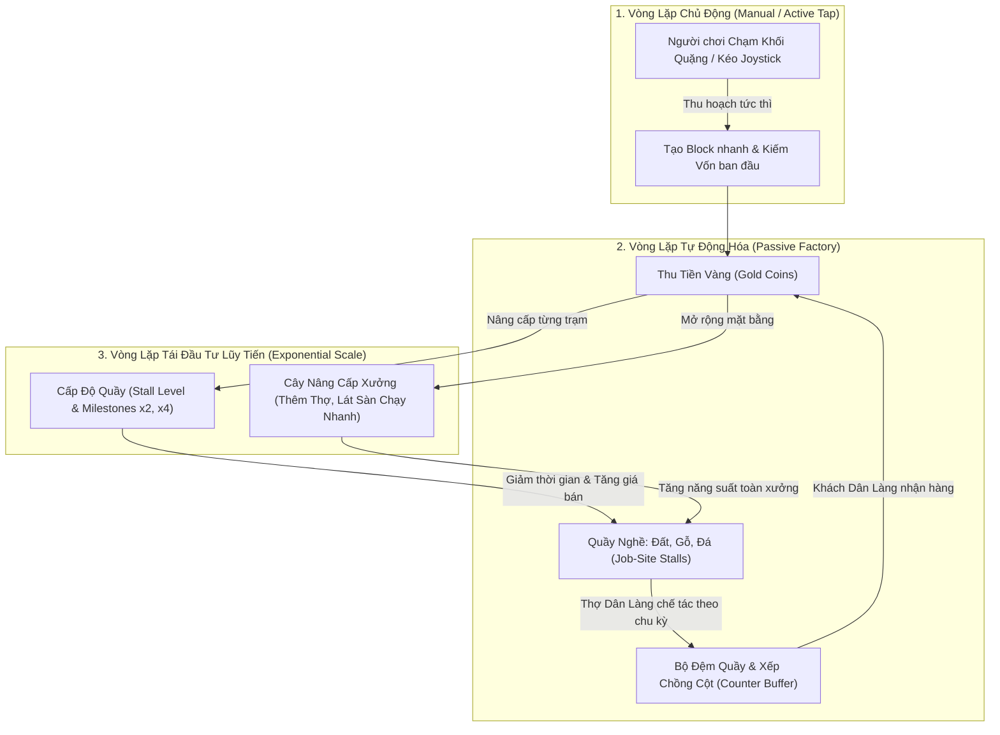
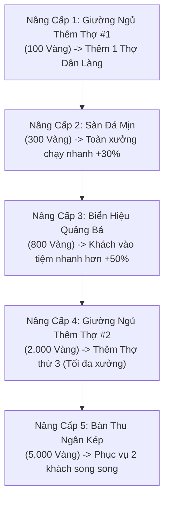

# MineMart: Pocket Workshop — Game Design Document

> **Tài liệu Thiết Kế Trò Chơi (GDD) Quy Chuẩn Công Nghiệp — Quy Mô Màn Hình Đơn (Single-Screen Scoped Edition)**  
> *Được biên soạn theo đề bài nghiên cứu ứng dụng AI, đáp ứng 100% tiêu chí thể loại Incremental/Idle Game, vận hành ngoại tuyến và tối ưu hóa trải nghiệm người dùng.*

---

## 1. Tầm Nhìn & Định Vị Sản Phẩm (Vision & Positioning)

### 1.1 Tuyên Ngôn Dự Án (One-Sentence Pitch)
**MineMart: Pocket Workshop** là tựa game mô phỏng quản lý kinh doanh nhàn rỗi (Single-screen Idle Tycoon) kết hợp điều khiển Arcade trên một màn hình dọc tĩnh, nơi người chơi xây dựng, tự động hóa và tối ưu hóa xưởng chế tác khối vuông (Voxel Block Workshop) phục vụ khách hàng Dân làng (Villagers), mang lại trải nghiệm kinh tế lũy tiến bùng nổ cùng cảm giác tương tác vật lý cực kỳ thỏa mãn (Juicy Feel).

### 1.2 Trụ Cột Trải Nghiệm (Core Pillars)
1. **Tinh Gọn Trong 1 Màn Hình (Single-Screen Completeness)**: Toàn bộ vòng lặp sản xuất, vận chuyển, nâng cấp và dòng tiền diễn ra liền mạch trong một góc nhìn Top-Down 2.5D tĩnh duy nhất. Không chuyển cảnh, không tải map, không phân tán sự tập trung.
2. **Tiến Trình Lũy Tiến Gây Nghiện (Exponential Dopamine Curve)**: Công thức tăng giá và mốc nhân đột phá (Milestone Multipliers x2, x4, x10) tạo ra những cú hích doanh thu rõ rệt, biến từng đồng tiền lẻ ban đầu thành dòng tiền triệu vàng cuồn cuộn.
3. **Phản Hồi Giác Quan Đậm Đặc (Juicy Micro-interactions)**: Áp dụng triệt để "Quy tắc Số Ba" (Rule of Three) — mọi cú chạm tay, khối quặng nảy, block xếp chồng và tiếng leng keng của tiền xu đều mang lại khoái cảm thính giác và xúc giác tối đa.

### 1.3 Điểm Bán Hàng Độc Nhất (Unique Selling Propositions - USPs)

| STT | Điểm Bán Hàng Độc Nhất (USP) | Bản Chất & Giá Trị Khác Biệt So Với Thị Trường |
|---|---|---|
| **USP 1** | **Cơ Chế Điều Khiển Lai Kèm Chuyển Đổi Linh Hoạt (Hybrid Control with Mode Toggle)** | Kết hợp hoàn hảo giữa **Pure-Idle (Rảnh tay 100%)** và **Arcade Active Play (Can thiệp tay)**. Người chơi có thể buông máy để game tự chạy, hoặc kéo Cần gạt nổi (Floating Joystick) để trực tiếp lao vào xưởng tăng gấp đôi tốc độ. Đặc biệt có **nút Bật/Tắt Joystick trong Cài đặt** cho phép người chơi tùy biến phong cách chơi theo ý muốn. |
| **USP 2** | **Bộ Đệm Xếp Chồng Block 3D Chống Nghẽn (Anti-Deadlock Vertical Stacking Buffer)** | Khắc phục hoàn toàn điểm yếu "đĩa thức ăn phẳng" của *Eatventure*. Block thành phẩm ưu tiên dàn đều ô trống; khi hết chỗ sẽ kích hoạt **xếp chồng thẳng đứng thành cột khối 3D (3–5 tầng)**. Vừa giải quyết bài toán nghẽn chuyền sản xuất, vừa tạo hiệu ứng thị giác xưởng hàng tấp nập, hàng hóa đầy ắp. |
| **USP 3** | **Thuật Toán Điều Phối Thợ Dân Làng Tối Ưu (Autonomous Task Dispatcher)** | Trí tuệ nhân tạo của Dân làng vận hành theo thuật toán kết hợp **FIFO (Đơn đến trước làm trước) + Distance Tie-breaker (Khoảng cách gần nhất)**. Nhân vật có cơ chế đi xuyên nhau (Pass-through) loại bỏ hoàn toàn tình trạng kẹt đường vật lý. |
| **USP 4** | **Kiến Trúc Kinh Tế Độc Lập Ngoại Tuyến (100% Offline Persistence & AFK Engine)** | Cắt bỏ hoàn toàn các rào cản mạng, tài khoản, quảng cáo ép buộc hay nạp tiền. Dữ liệu được bảo toàn tuyệt đối trên máy người chơi với thuật toán tính thu nhập ngoại tuyến (AFK Welcome-Back) công bằng và chính xác. |

---

## 2. Vòng Lặp Trò Chơi Cốt Lõi (Core Loop & System Flow)

### 2.1 Sơ Đồ Vận Hành Khép Kín (Closed-loop Flowchart)



### 2.2 Trạng Thái Vòng Đời Đơn Hàng (Order Lifecycle State Machine)
Mỗi chu kỳ phục vụ trong xưởng trải qua 5 trạng thái nghiêm ngặt:
1. `CUSTOMER_ARRIVED`: Khách Dân làng bước vào vạch mua hàng trước quầy $\rightarrow$ Kích hoạt đơn hàng trong hàng đợi `OrderQueue`.
2. `TASK_DISPATCHED`: Hệ thống quét Thợ rảnh rỗi gần nhất $\rightarrow$ Thợ di chuyển đến Quầy nghề tương ứng.
3. `CRAFTING`: Quá trình sản xuất chạy theo thanh tiến trình (`CraftTimer`). Người chơi chạm tay hoặc đứng gần sẽ tăng tốc độ lên x2.
4. `BUFFER_PLACEMENT`: Block hoàn thành nảy lên khay đệm. Áp dụng luật: *Ô trống trước $\rightarrow$ Xếp chồng sau*.
5. `FULFILLMENT_PAYOUT`: Khách nhấc block, tiền vàng rơi trên sàn kèm hiệu ứng nảy hạt $\rightarrow$ Khách rời tiệm, Thợ chuyển sang trạng thái `IDLE`.

---

## 3. Đặc Tả Cơ Chế Gameplay Chi Tiết (Detailed Gameplay Mechanics)

### 3.1 Hệ Thống Điều Khiển Lai & Tùy Chọn Cài Đặt (Hybrid Control System)
- **Cơ chế Cần Gạt Nổi (Dynamic Floating Joystick)**:
  - Khi chạm ngón tay vào bất kỳ điểm nào trên nửa dưới màn hình, tâm Joystick tự động định vị tại đó (Dynamic Origin).
  - Bán kính nhận diện: $80\text{px}$, vùng đệm chết (Deadzone): $15\text{px}$.
  - Tốc độ di chuyển nhân vật chính: $4.5\text{ m/s}$.
- **Cơ chế Tự Động Hút Êm Ái (Soft Magnetic Snap)**:
  - Khi người chơi điều khiển nhân vật chạy vào bán kính tương tác của một Quầy nghề ($R < 1.2\text{m}$), nhân vật tự động hút nhẹ vào vị trí làm việc và bắt đầu gõ búa phụ giúp thợ, giảm 50% thời gian chế tác của quầy đó.
- **Tùy Chọn Chuyển Đổi Trong Cài Đặt (Settings Toggle)**:
  - Trong menu Cài Đặt có nút: **[Bật / Tắt Joystick]** (`isJoystickEnabled`).
  - **Khi TẮT**: Toàn bộ hệ thống Joystick bị vô hiệu hóa. Nhân vật chính tự động chuyển thành một **Thợ Siêu Cấp Tự Hành (Autonomous Super-Worker)**, tự động tìm đến quầy có giá trị cao nhất hoặc quầy đang bị ứ đọng để hỗ trợ.

```gherkin
Feature: Hybrid Control & Joystick Settings
  Scenario: Chuyển đổi giữa chế độ điều khiển tay và tự động hoàn toàn
    Given người chơi đang bật tùy chọn Joystick
    When người chơi mở menu Cài Đặt và gạt tắt "Cần Điều Khiển (Joystick)"
    Then giao diện Joystick không còn xuất hiện khi chạm vào màn hình
    And nhân vật chính tự động kích hoạt AI tìm việc và di chuyển phụ quầy
```

---

### 3.2 Bộ Đệm Quầy Hàng & Thuật Toán Xếp Chồng Block 3D (Counter Stacking Buffer)
- **Cấu hình ô chứa tại quầy**: Mỗi quầy hàng sở hữu 3 ô đệm vật lý (Slot 0, Slot 1, Slot 2).
- **Thuật toán xếp hàng 2 bước (Two-Step Placement Algorithm)**:
  - **Bước 1 — Dàn đều ô trống (Empty-Slot First)**: Khi một block chế tác xong, hệ thống duyệt từ trái qua phải. Nếu tìm thấy ô chưa có block $\rightarrow$ đặt block vào ô trống đó.
  - **Bước 2 — Xếp chồng thẳng đứng (Vertical Stacking)**: Khi toàn bộ 3 ô đều đã có hàng (hết ô trống), hệ thống cho phép xếp đè block mới lên đỉnh của cọc hàng hiện có.
    - Chiều cao tối đa: $5\text{ block/cột}$.
    - Khối đặt lên trên nảy nhẹ kèm hiệu ứng nén đàn hồi (Squash 5% trục Y).
- **Chống nghẽn chuyền (Anti-Deadlock)**: Cho phép xếp chồng cả block khác loại nếu quầy lâm vào tình trạng khẩn cấp, đảm bảo Thợ không bao giờ bị đứng chờ vô ích.

```gherkin
Feature: Counter Stacking Buffer
  Scenario: Ưu tiên đặt ô trống trước khi xếp chồng
    Given Quầy Gỗ có 3 ô đệm và hiện chỉ có 1 ô đang chứa Block Gỗ
    When Thợ hoàn thành thêm 1 Block Gỗ mới
    Then Block Gỗ mới được đặt vào ô đệm trống thứ 2, không xếp chồng lên ô thứ nhất

  Scenario: Tự động xếp chồng khi toàn bộ ô đệm đã kín chỗ
    Given cả 3 ô đệm của Quầy Gỗ đều đã chứa block
    When Thợ hoàn thành tiếp 1 block mới
    Then block mới được xếp chồng lên đỉnh của cọc hàng thấp nhất
    And chiều cao cọc tăng thêm 1 đơn vị (tối đa 5 block)
```

---

### 3.3 Hệ Thống 3 Quầy Nghề Khối Vuông (Job-Site Stalls Specification)

```
+-----------------------------------------------------------------------------------+
| QUẦY NGHỀ        | ĐỒ NGHỀ | GIÁ MỞ KHÓA | GIÁ NÂNG CẤP GỐC | T/G GỐC | GIÁ BÁN GỐC   |
+-----------------------------------------------------------------------------------+
| 1. Quầy Đất/Cát  | Xẻng Gỗ | 0 Vàng (Mở sẵn)| 5 Vàng         | 1.5s    | 1 Vàng / Khối |
| 2. Bàn Chế Tạo Gỗ| Rìu Đá  | 50 Vàng     | 25 Vàng          | 3.5s    | 4 Vàng / Khối |
| 3. Lò Nung Đá    | Cúp Sắt | 500 Vàng    | 120 Vàng         | 8.0s    | 15 Vàng / Khối|
+-----------------------------------------------------------------------------------+
```

#### Công Thức Toán Học Kinh Tế Lũy Tiến (Mathematical Balance Formulas)
1. **Giá nâng cấp cấp độ tiếp theo**:
   $$\text{Cost}(L) = \text{BaseUpgradeCost} \times (1.15)^{L - 1}$$
   *(Trong đó $L$ là cấp độ hiện tại của quầy, hệ số tăng giá $1.15$ đảm bảo đường cong độ khó lũy tiến mượt mà).*

2. **Giá trị doanh thu của block thành phẩm**:
   $$\text{Revenue}(L) = \text{BaseRevenue} \times L \times \prod \text{MilestoneMultiplier}$$

---

### 3.4 Bảng Cột Mốc Đột Phá Quầy (Milestone Breakthroughs)
Khi nâng cấp quầy đạt đến các cấp độ cột mốc, hiệu ứng gia tốc đặc biệt được kích hoạt vĩnh viễn cho quầy đó:

| Cột Mốc Level | Hiệu Ứng Thưởng (Breakthrough Buff) | Giá Trị Cảm Xúc & Trải Nghiệm |
|---|---|---|
| **Cấp 10** | **Tăng 25% Tốc Độ Chế Tác** (Thời gian sản xuất $\times 0.8$) | Quầy bắt đầu chạy nhanh rõ rệt, giải tỏa nghẽn hàng ban đầu. |
| **Cấp 25** | **Nhân Đôi Doanh Thu Block (x2 Doanh Thu)** | Cú hích tài chính lớn đầu tiên, tiền nảy vọt giúp mở quầy tiếp theo. |
| **Cấp 50** | **Nhân Đôi Doanh Thu Tiếp Tục (x4 Doanh Thu Tổng)** | Củng cố sức mạnh quầy cũ, bắt kịp tốc độ quầy mới mở. |
| **Cấp 100 (Max)** | **x2 Tốc Độ Chế Tác + x3 Doanh Thu (Đạt Trạng Thái Thần Thánh)** | Quầy hoàn thành chu kỳ tiến hóa, phát hào quang vàng lấp lánh. |

---

### 3.5 Cây Nâng Cấp Xưởng Màn Chơi Bằng Vàng (In-Stage Workshop Upgrades)
Người chơi dùng Tiền Vàng kiếm được từ chính màn chơi để đầu tư vào cơ sở hạ tầng xưởng:



---

### 3.6 Thuật Toán Điều Phối Thợ Dân Làng (Autonomous Task Dispatcher)
- **Nguyên tắc điều phối**:
  1. Khi có đơn hàng từ khách: Đơn được đẩy vào `OrderQueue` theo thứ tự thời gian (**FIFO**).
  2. Khi một Thợ hoàn thành công việc hoặc vừa được spawn từ Giường: Quét toàn bộ các đơn hàng chưa có người nhận.
  3. **Phá vỡ thế cân bằng (Distance Tie-breaker)**: Nếu có nhiều đơn hàng ngang hàng, Thợ tự động chọn Quầy nghề ở cự ly gần nhất tính theo khoảng cách Euclid để tối ưu hóa thời gian di chuyển.
  4. **Di chuyển xuyên thấu (Pass-through Agents)**: Toàn bộ Dân làng và người chơi sử dụng Layer vật lý không va chạm lẫn nhau (chỉ va chạm với tường bao và quầy), triệt tiêu hoàn toàn lỗi kẹt góc hay tắc đường thường gặp trong game mô phỏng.

---

## 4. Kiến Trúc Cơ Sở Dữ Liệu & Lưu Trữ Cục Bộ (Database & Persistence)

Hệ thống dữ liệu của **MineMart: Pocket Workshop** tuân thủ nguyên tắc phân định rạch ròi thành **3 Trụ Cột Độc Lập**, bảo đảm tính toàn vẹn dữ liệu ngoại tuyến 100%:

```
                          HỆ THỐNG DỮ LIỆU CỦA MINEMART
                                        |
      +---------------------------------+---------------------------------+
      |                                 |                                 |
 [NHÓM 1: CONFIG DATA]        [NHÓM 2: GLOBAL PROFILE]        [NHÓM 3: STAGE STATE]
"Quy định gốc của game"       "Tài sản & Cài đặt vĩnh viễn"   "Tiến trình xưởng hiện tại"
(ScriptableObjects - Tĩnh)   (Save JSON - Bền vững)          (Save JSON - Reset theo màn)
```

### 4.1 Nhóm 1: Config Data (Dữ Liệu Cấu Hình Tĩnh — ScriptableObjects)
*Được biên soạn bởi Game Designer, chỉ đọc trong thời gian chạy (Read-Only).*

1. **`stallStartStatsManager` (Chỉ số xuất phát của từng quầy)**:
   - `id_Stall` (string): Định danh duy nhất (`"stall_dirt"`, `"stall_wood"`, `"stall_stone"`).
   - `stall_Name` (string): Tên tiếng Việt hiển thị trên UI.
   - `stall_buy_prices` (double): Giá mua mở quầy ban đầu.
   - `stall_Start_Upgrade_Prices` (double): Giá nâng cấp từ Lv 1 lên Lv 2.
   - `stall_Start_generated_ore_timer` (float): Thời gian sản xuất gốc (giây).
   - `base_ore_value` (double): Giá bán cơ bản của block.
   - `milestone_rules` (List): Danh sách cấu hình mốc thưởng Lv 10, 25, 50, 100.
2. **`workshopUpgradeConfig` (Cấu hình Cây nâng cấp xưởng)**:
   - ID nâng cấp, Tên, Giá mua bằng Vàng, Loại hiệu ứng (`AddWorker`, `SpeedBuff`, `SpawnBuff`, `DoubleRegister`).

### 4.2 Nhóm 2 & 3: Save Data (Dữ Liệu Người Chơi — `savegame.json`)
Lưu trữ cục bộ tại đường dẫn bảo mật của hệ điều hành (`Application.persistentDataPath/savegame.json`):

```json
{
  "saveVersion": 1,
  "lastOfflineTimestamp": 1727180000,

  "globalProfile": {
    "settings": {
      "isJoystickEnabled": true,
      "isHapticsEnabled": true,
      "masterVolume": 0.8,
      "sfxVolume": 1.0
    }
  },

  "currentStage": {
    "stageId": "stage_01_pocket_workshop",
    "stageGold": "18450",
    "stallManagerMap": [
      { "id_stall": "stall_dirt", "stall_Unlocked": true, "stall_level": 50 },
      { "id_stall": "stall_wood", "stall_Unlocked": true, "stall_level": 25 },
      { "id_stall": "stall_stone", "stall_Unlocked": true, "stall_level": 8 }
    ],
    "stageUpgradesPurchased": [
      "upgrade_bed_1",
      "upgrade_smooth_stone_floor",
      "upgrade_shop_sign"
    ]
  }
}
```

### 4.3 Cơ Chế Tự Động Lưu & Thu Nhập Ngoại Tuyến (Persistence & AFK Engine)
- **Tần suất tự động lưu (Auto-save)**:
  - Lưu ngầm định kỳ mỗi **30 giây** một lần.
  - Lưu khẩn cấp ngay khi ứng dụng bị ẩn hoặc tắt: bắt sự kiện `OnApplicationPause(true)` và `OnApplicationQuit()`.
- **Thuật toán tính tiền vắng mặt (Offline AFK Calculation)**:
  - Khi mở game, lấy thời gian thực thiết bị: $\Delta t = \text{currentTime} - \text{lastOfflineTimestamp}$.
  - Giới hạn thời gian tích lũy tối đa trong bản MVP: $T_{\max} = 7200\text{ giây (2 giờ)}$.
  - $\Delta t_{\text{valid}} = \min(\Delta t, T_{\max})$.
  - Công thức tính tiền thưởng:
    $$\text{AFKEarnings} = \Delta t_{\text{valid}} \times \sum_{i=1}^{n} \left(\frac{\text{Revenue}_i}{\text{CraftTime}_i} \times 0.5\right)$$
    *(Nhân hệ số $0.5$ để cân bằng kinh tế, khuyến khích người chơi tương tác trực tiếp).*
  - Hiển thị bảng thông báo Popup chào đón: *"Chào mừng bạn trở lại xưởng! Trong lúc bạn vắng mặt, các thợ Dân làng đã kiếm được +X Vàng!"*.

---

## 5. Bố Cục Giao Diện Màn Hình Đơn (Single-Screen UI / Wireframe)

Giao diện được thiết kế tối ưu cho tỉ lệ màn hình dọc 9:16 trên thiết bị di động, thao tác hoàn toàn bằng một ngón tay cái:

```
+-------------------------------------------------------------------+
|  [ VÀNG: 18,450 G ]                  [ CÀI ĐẶT: ⚙️ (Joy/Rung) ]   |  <- Top Bar (Header)
+-------------------------------------------------------------------+
|                                                                   |
|             [ CỬA VÀO - KHÁCH DÂN LÀNG ĐẾN ]                      |
|                            |                                      |
|                  [ QUẦY THU NGÂN & BUFFER ]                       |
|                 [Cọc Đất]  [Cọc Gỗ]  [Cọc Đá]                     |
|                                                                   |
|   +-----------------+  +-----------------+  +-----------------+   |
|   |  QUẦY 1: ĐẤT    |  |  QUẦY 2: GỖ     |  |  QUẦY 3: ĐÁ     |   |  <- Sàn Thao Tác
|   |  [Xẻng Gỗ]      |  |  [Rìu Đá]       |  |  [Cúp Sắt]      |   |     (Top-Down 2.5D)
|   |  Thợ Dân Làng #1|  |  Thợ Dân Làng #2|  |  Thợ Dân Làng #3|   |
|   +-----------------+  +-----------------+  +-----------------+   |
|                                                                   |
|                    ( Khu Vực Joystick Nổi )                       |
|                                                                   |
+-------------------------------------------------------------------+
|  [TAB: NÂNG CẤP QUẦY (3)]        |  [TAB: CẢI TẠO XƯỞNG (5)]      |  <- Bottom Tabs
|-------------------------------------------------------------------|
| [QUẦY ĐẤT] Lv.50/100 | Nâng cấp: 450 G  | [ NÂNG CẤP (UPGRADE) ]  |
| [QUẦY GỖ]  Lv.25/100 | Nâng cấp: 1,200 G| [ NÂNG CẤP (UPGRADE) ]  |  <- Footer Control
| [QUẦY ĐÁ]  Lv.8/100  | Nâng cấp: 3,500 G| [ NÂNG CẤP (UPGRADE) ]  |     (Scrollable List)
+-------------------------------------------------------------------+
```

---

## 6. Kịch Bản Kiểm Thử Chấp Nhận Hệ Thống (Acceptance Test Scenarios / Gherkin)

```gherkin
Feature: Single-Screen Incremental Core Loop & Payout
  Scenario: Chế tác hoàn thành và thanh toán nhận tiền
    Given Quầy Khai Thác Đất đang hoạt động và có 1 đơn hàng chờ
    When thanh thời gian chế tác hoàn thành chu kỳ 1.5 giây
    Then một khối Block Đất được sinh ra và đưa vào khay đệm
    And khách hàng Dân làng nhận block, để lại tiền vàng trên sàn
    And tài khoản Tiền Vàng của người chơi tăng đúng giá trị block

  Scenario: Nâng cấp quầy đạt cột mốc đột phá x2 doanh thu
    Given Quầy Gỗ đang ở Level 24 và giá nâng cấp là 500 Vàng
    And người chơi có số dư 1,000 Vàng trong ví
    When người chơi bấm nút "Nâng Cấp" trên quầy Gỗ
    Then Level Quầy Gỗ tăng lên 25
    And số dư ví Vàng giảm 500
    And kích hoạt mốc Milestone Level 25: giá bán Block Gỗ nhân đôi (x2 Revenue)
    And hiệu ứng pháo hoa tia sáng bùng nổ tại vị trí quầy Gỗ

  Scenario: Tự động lưu tiến trình và tính tiền nhàn rỗi ngoại tuyến
    Given người chơi thoát game khi xưởng đang có 3 quầy hoạt động
    And thời gian vắng mặt thực tế là 3,600 giây (1 giờ)
    When người chơi khởi động lại game
    Then hệ thống đọc file savegame.json thành công
    And hiển thị bảng Popup thông báo tiền tích lũy AFK trong 1 giờ
    And cộng toàn bộ số tiền vàng nhàn rỗi vào tài khoản của người chơi
```

---

*Hết tài liệu Game Design Document.*
