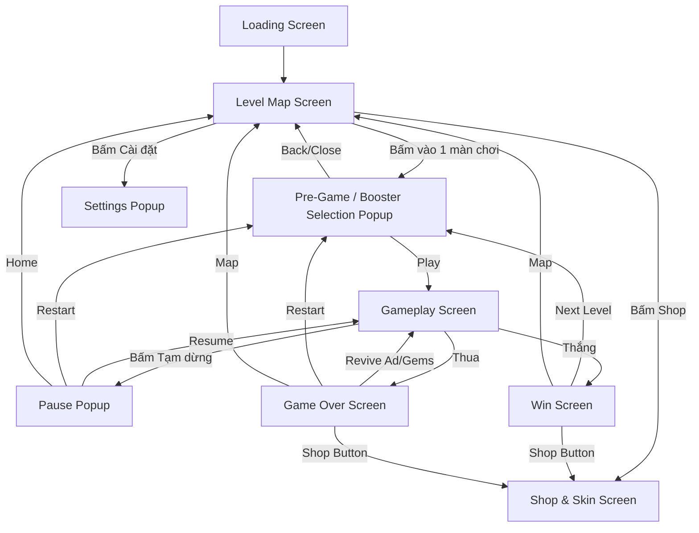

# 📱 UI Screen Flow & State Machine

Tài liệu này định nghĩa tất cả các màn hình (Screens), chức năng (Functions) và luồng điều hướng (Navigation Flow) cho dự án Game Match-3D.

## 1. Sơ Đồ Điều Hướng (Screen Flow Map)

## 2. Thông tin chi tiết các màn hình (Screens & Popups)

### A. Loading Screen
- **Chức năng:** Tải Asset, check Firebase version, đăng nhập ẩn danh & đồng bộ dữ liệu.
- **Thành phần UI:** Logo game, Thanh Progress Bar.

### B. Level Map Screen (Thay thế Home Menu cũ)
- **Chức năng:** Lối chơi dạng bản đồ tuyến tính (Saga). Người chơi thấy được quá trình thăng tiến của mình trực quan hơn. Kích thích sự ganh đua.
- **Thành phần UI:** 
  - Đường nối liền các điểm (Nodes) tượng trưng cho các Level.
  - Mỗi Node hiển thị vương miện/sao đã đạt được.
  - **Leaderboard (Chức năng cốt lõi):** Tại mỗi Node, sẽ ghim hiển thị top 3 Avatar + Số điểm của những người có kỷ lục cao nhất ở Level đó. 
  - HUD (Góc trên): Số lượng Tiền Vàng, Số lượng Gem (Kèm nút bấm trực tiếp vào Shop). Nút Settings.
  
### C_Pre. Pre-game / Booster Selection Popup
- **Chức năng:** Xuất hiện đè lên Level Map khi người dùng bấm vào 1 Level. Là nơi trang bị vũ khí hỗ trợ trước khi xông pha.
- **Thành phần UI:** 
  - Tên/Số level hiện tại. Mục tiêu của Level.
  - **Khu vực gắn Booster:** Giao diện cho phép chọn để trang bị tối đa **2 loại Booster** (Hint, Shake). Có thể mở khóa/mua thêm **slot thứ 3**.
  - **Limit Booster:** Có nút tăng giảm số lượng mang vào cho mỗi loại Booster (Tối đa x3 lượng dùng mỗi loại). Các thông số giới hạn (Max slot = 2/3, Max amount = 3) được Fetch từ Admin Server.
  - Nút **PLAY** rất lớn. Nút tắt (X) quay lại Bản đồ.

### C. Gameplay Screen
- **Chức năng:** Màn hình chơi chính của game. Tối giản để ưu tiên góc máy 3D.
- **Thành phần UI:** 
  - Thang đo ngực nước / Timer đếm ngược.
  - Khay chứa (Tray) nằm dưới cùng.
  - Cụm nút Bật/Tắt (Toggle) Nhanh: **Sound** và **Music** (Góc trên, bên trái/phải nhỏ gọn) để tiện tắt tiếng đi làm/học.
  - Nút Tạm Dừng (**Pause**).
  - Cụm icon Booster (Chỉ hiển thị các Booster đã chọn từ bước **C_Pre**).

### G. Pause Popup
- **Chức năng:** Cửa sổ thiết lập trong khi chơi, có làm tối/mờ (Dim) background game.
- **Thành phần UI:** 
  - Nút **Resume** (Tiếp tục).
  - Nút **Restart Level** (Bắt đầu lại màn).
  - Nút **Quit to Map** (Thoát ra bản đồ).
  - **Thanh trượt (Slider):** Chỉnh âm lượng BGM (Nhạc nền) và SFX (Hiệu ứng), lưu vào Global Settings thiết bị (PlayerPrefs).

### H. Win (Victory) Screen
- **Chức năng:** Màn hình trả thưởng mạnh mẽ, tạo khao khát ấn tượng.
- **Thành phần UI:** Điểm số, Đánh giá sao, Pháo sáng vàng. Nút **Next Level** (Chuyển sang C_Pre của map tiếp theo), Nút xem quảng cáo x2 thưởng, Nút **Map**.
- **Button Shop:** Bổ sung nút chuyển hướng nhanh sang Shop để tiêu tiền vừa kiếm được.

### I. Game Over (Defeat) Screen
- **Chức năng:** Hiển thị lý do thua, dụ dỗ người chơi dùng mạng hoặc tiêu Gem để hồi sinh.
- **Thành phần UI:** Nút **Revive** to, chớp sáng. Nút **Restart Level**.
- **Button Shop:** Thêm nút đưa tới thẳng Shop để mua nguyên liệu nâng cấp/Booster cho lần chơi sau.

### D. Shop & Skin Screen
- **Chức năng:** Meta-game economy. Cửa hàng IAP và Soft Currency.
- **Thành phần UI:** Có thể chia theo cấu trúc Tab. Nút Tắt (X) luôn đưa người chơi quay về Màn hình trước đó (Level Map, Win, hoặc Lose).

### F. Global Settings Popup
- **Chức năng:** Lối vào từ Level Map, để config tài khoản và setting cấu hình.
- **Thành phần UI:** Slider Âm lượng, Nút Link Account (Apple/Google), Nút Khôi phục thanh toán IAP (Restore Purchases).

---
## 3. Quản lý trạng thái (State Machine) đề xuất
Để thiết kế giao diện theo luồng trên một cách mượt mà và không dính rác bộ nhớ, dự án nên sử dụng một `UIManager` State-Machine:

- Lớp phủ (Overlays): Screen A, B, C, D nằm ở layer Screens gỡ độc lập.
- Lớp cửa sổ (Popups): Popup G, C_Pre, F nằm ở lớp cao hơn, khi gọi sẽ dừng thao tác ở màn hình dưới nền.
